# 四科错题本 · 高等代数 / 数学分析 / 解析几何 / 西方经济学

在线使用：**https://lanzaihua.github.io/**

一个单文件静态网页错题本，把四门课的错题、章节、模板、举一反三题库和 AI 智能录入放在同一个页面里。打开就能用，不需要注册账号，数据默认只保存在当前浏览器。

## 更新记录

默认只显示最近更新；历史更新折叠，点开再看。网页内可在「设置与同步 → 更新记录」主动查看，不会自动弹出。完整记录见 [CHANGELOG.md](CHANGELOG.md)。

> 维护约定：每次更新会同步更新 README 最近更新、CHANGELOG.md 和网页内更新记录。

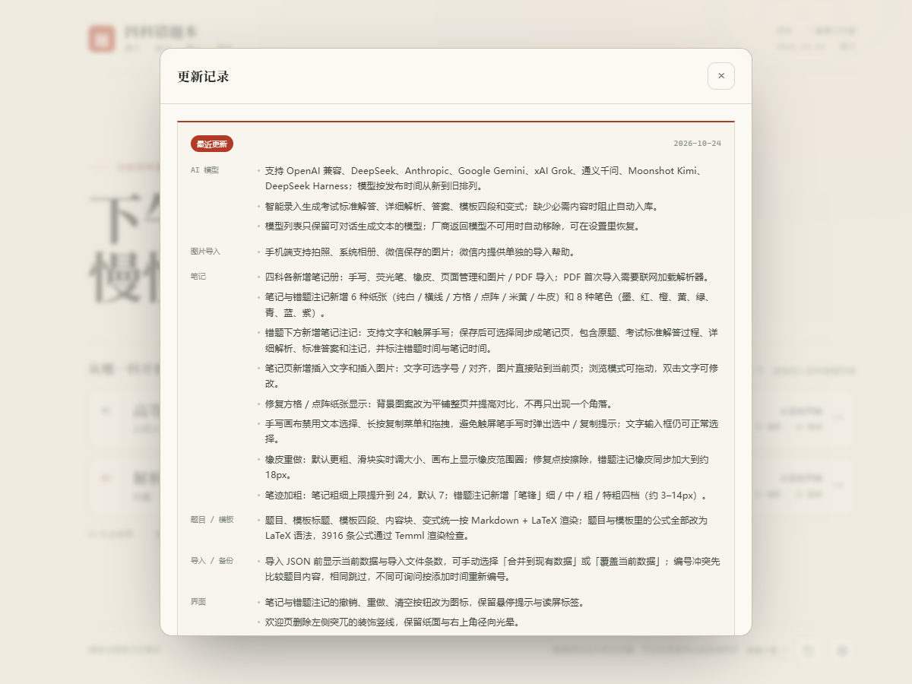

### 最近更新 · 2026-10-24

- 笔记：6 种纸张、8 种笔色、插入文字 / 图片、更粗笔锋、橡皮范围圈。
- 错题：编号统一为 A / M / G / E，空状态改为「手动新增 + 智能录入」。
- 界面：操作图标化、更新记录单滚动条、欢迎页清理。
- 设备：Flip / Fold / TriFold、iPad mini、OPPO Pad Mini、Mate XT 等阅读适配。
- AI 与导入：模型列表、图片导入、合并备份保持更新。


<details>
<summary>历史更新 · 2026-10-23（点开查看）</summary>

- 四科错题本上线：高等代数、数学分析、解析几何、西方经济学。
- 118 张解答模板、92 道举一反三题库。
- 每道题可标「已掌握 / 未掌握」，支持搜索、筛选、导出和导入。
- 数据默认保存在浏览器 localStorage；可选本机 server.js 跨设备同步。
- 智能录入与录入后自动补全队列。

</details>

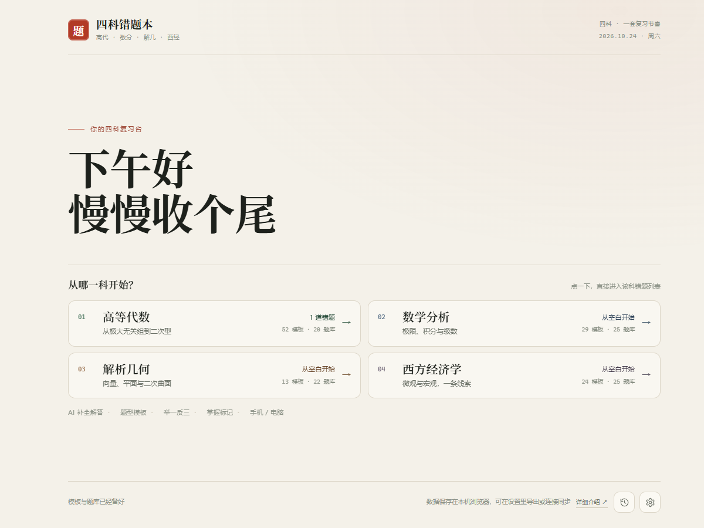

## 这是什么

这是一个面向大学数学与经济学基础课的错题整理工具：

- **高等代数**：行列式、矩阵、线性方程组、向量空间、线性变换、特征值、二次型、欧氏空间等。
- **数学分析**：极限、连续、导数、积分、级数、多元微积分、曲线曲面积分等。
- **解析几何**：向量与坐标、平面与空间直线、柱面锥面旋转曲面、二次曲线与二次曲面、轨迹等。
- **西方经济学**：微观的供求、弹性、消费者、生产者、成本、市场结构、要素市场、一般均衡、市场失灵；宏观的 GDP、IS-LM、AD-AS、失业、通胀、增长等。

页面按四科分开建册，每科有自己的编号、章节、模板和题库，互不混淆。

## 内容规模

| 科目 | 解答模板 | 举一反三题库 |
|---|---:|---:|
| 高等代数 | 52 | 20 |
| 数学分析 | 29 | 25 |
| 解析几何 | 13 | 22 |
| 西方经济学 | 24 | 25 |
| **合计** | **118** | **92** |

- 模板覆盖「识别特征 / 首选方法 / 步骤骨架 / 易错点」四段。
- 题库为自拟变式，不是教材原题，按章节和模板标注来源。
- **初始错题本为空**：四科错题数都是 0，模板库与题库保留，打开就能录入第一道题。

## 核心功能

### 1. 错题记录与掌握状态

- 每道错题有册内唯一编号，统一为「科目前缀 + 三位序号」：高代 `A-001`、数分 `M-001`、解几 `G-001`、西经 `E-001`。
- 可标记 **已掌握 / 未掌握**，首页和科目页同步统计进度。
- 记录原题、考试标准解答、详细解析、答案、模板、章节、知识要点、难度、错因标签。
- 支持按关键词、章节、模板、难度、掌握状态筛选。
- 条目支持编辑、删除、展开阅读，长解答不会撑坏版式。
- 空状态提供「手动新增 / 智能录入」两个入口，按钮样式和功能与页面顶部一致。

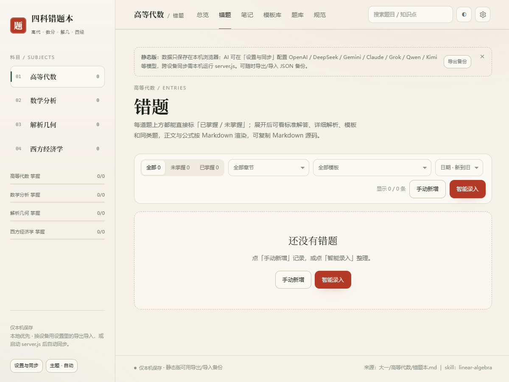

### 2. 解答模板与举一反三

- 118 张模板按科目和章节组织，可单独浏览、搜索。
- 92 道题库题可展开查看标准解答、详细解析、答案和解题要点。
- 支持「先自己做，再对照答案」的使用方式；题目和解答分开显示。
- 模板和题库是学习材料，不等同于教材原文，使用时应结合课本核对。

### 3. Markdown 与数学排版

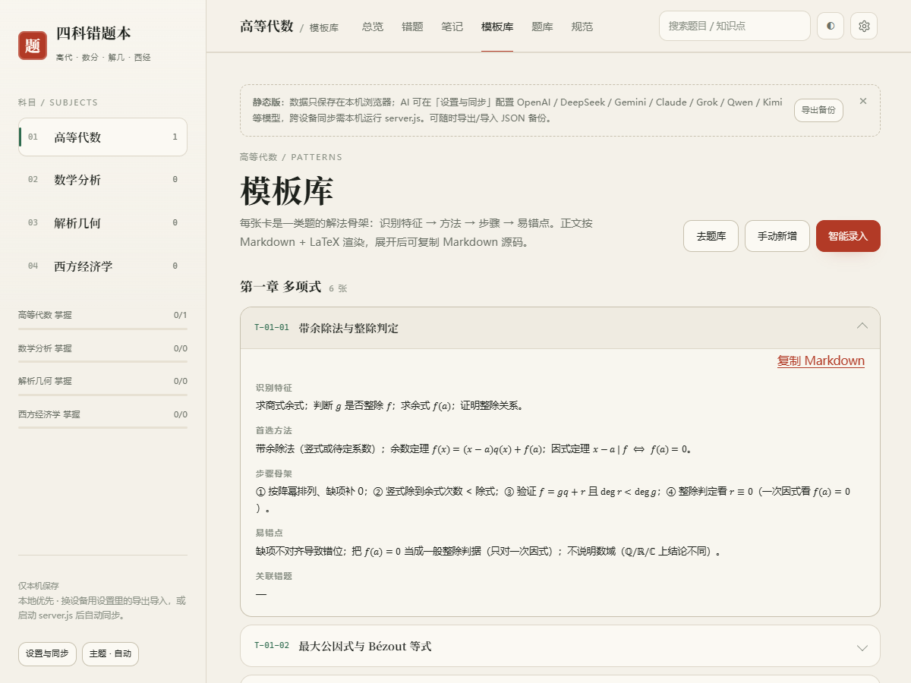

- 题目、模板标题、模板四段、内容块、变式均按 Markdown + LaTeX 渲染。
- 模板库、题库和错题条目都提供「复制 Markdown」，可复制带标题层级的 Markdown 源码。
- 模板编辑器的模板要点也支持 Markdown 与 $...$ 公式。
- 数学公式使用 LaTeX 语法渲染，矩阵、分段函数、积分、求和、极限等都能正常显示。
- 支持粘贴图片、上传题目照片、手机拍照或从系统相册 / 微信保存的图片中选择，图片会随条目保存。
- 页面采用纸张、墨色、朱砂批注的视觉语言，桌面和手机都能使用，并提供浅色 / 深色 / 跟随系统三种主题。
- 顶栏右上角和欢迎页底部都有齿轮图标，打开「设置与同步」。

### 4. 笔记与标注


每科都有独立笔记册，和错题、模板、题库放在同一套导航里。

- **笔锋**：笔记粗细上限 24，默认 7；错题注记提供细 / 中 / 粗 / 特粗四档（约 3–14px）。
- **橡皮**：默认约 21px，可用「橡皮」滑块调到 60px；画布实时显示橡皮范围圈，点按也能擦掉。
- **手写**：手指或触控笔直接写在纸面画布上；笔、荧光笔、橡皮、粗细可调；支持墨、红、橙、黄、绿、青、蓝、紫 8 种笔色。画布禁用了文本选择与长按复制菜单，触屏笔书写不会误触选中。
- **纸张**：纯白、横线、方格、点阵、米黄、牛皮 6 种；错题注记与笔记页都可以切换，方格 / 点阵会平铺整页。
- **插入文字**：文字框可选字号、左对齐 / 居中；浏览模式可拖动，双击可修改。
- **插入图片**：把图片贴到当前笔记页，保留原页背景；浏览模式可拖动，可删除选中内容。
- **页面**：新建白纸、翻页、删除页面；空白页带淡横线，图片和 PDF 页面保留原背景。
- **导入**：支持 JPG / PNG / WebP 等图片多选，也支持 PDF 逐页转成可标注页面。
- **错题注记**：每道错题展开后可在下方输入文字或触屏手写；保存后询问是否同步到笔记模块。
- **同步页**：包含原题、考试标准解答过程、详细解析、标准答案、用户注记，标注错题时间与笔记时间；再次同步会更新原页。
- **保存**：笔记只存在本机，和错题一起进入 JSON 备份；PDF 首次导入需要联网加载解析器。

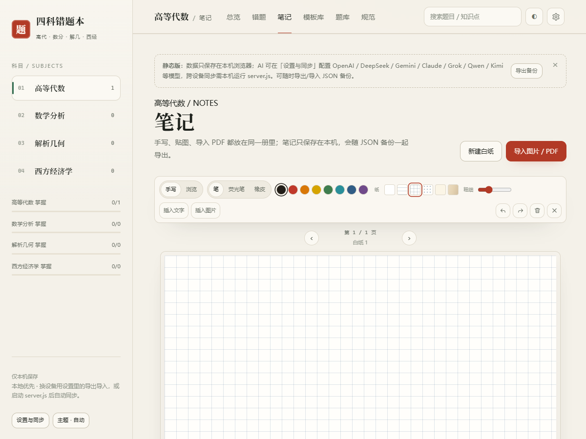

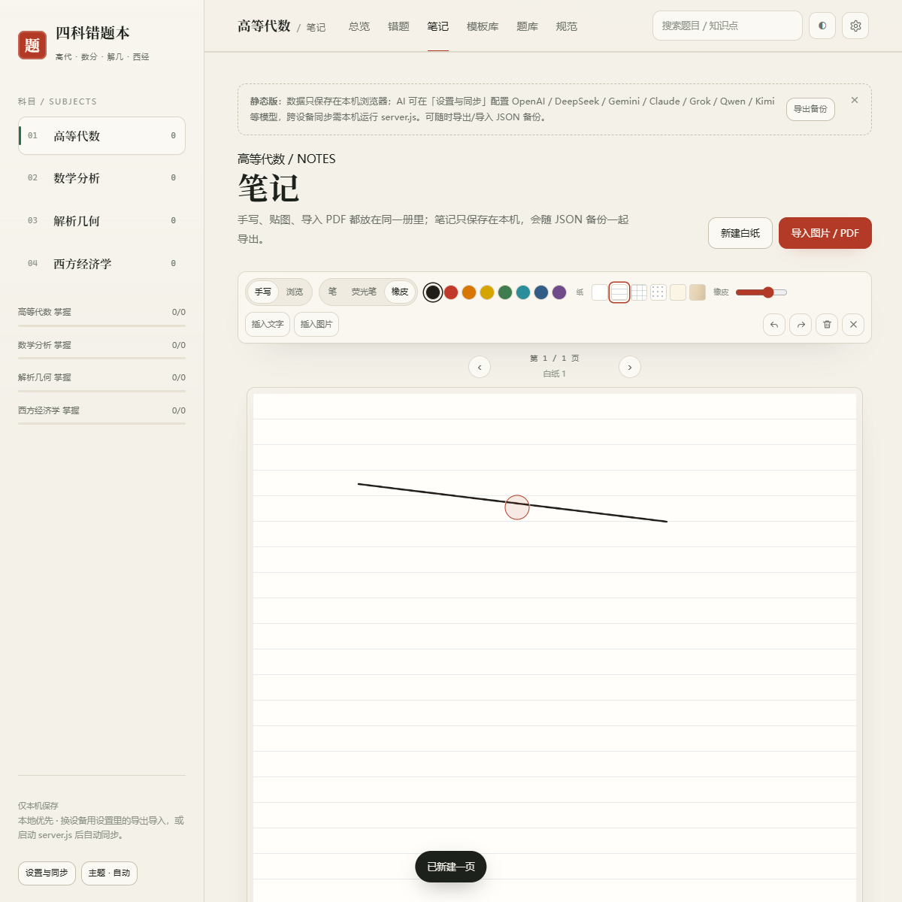

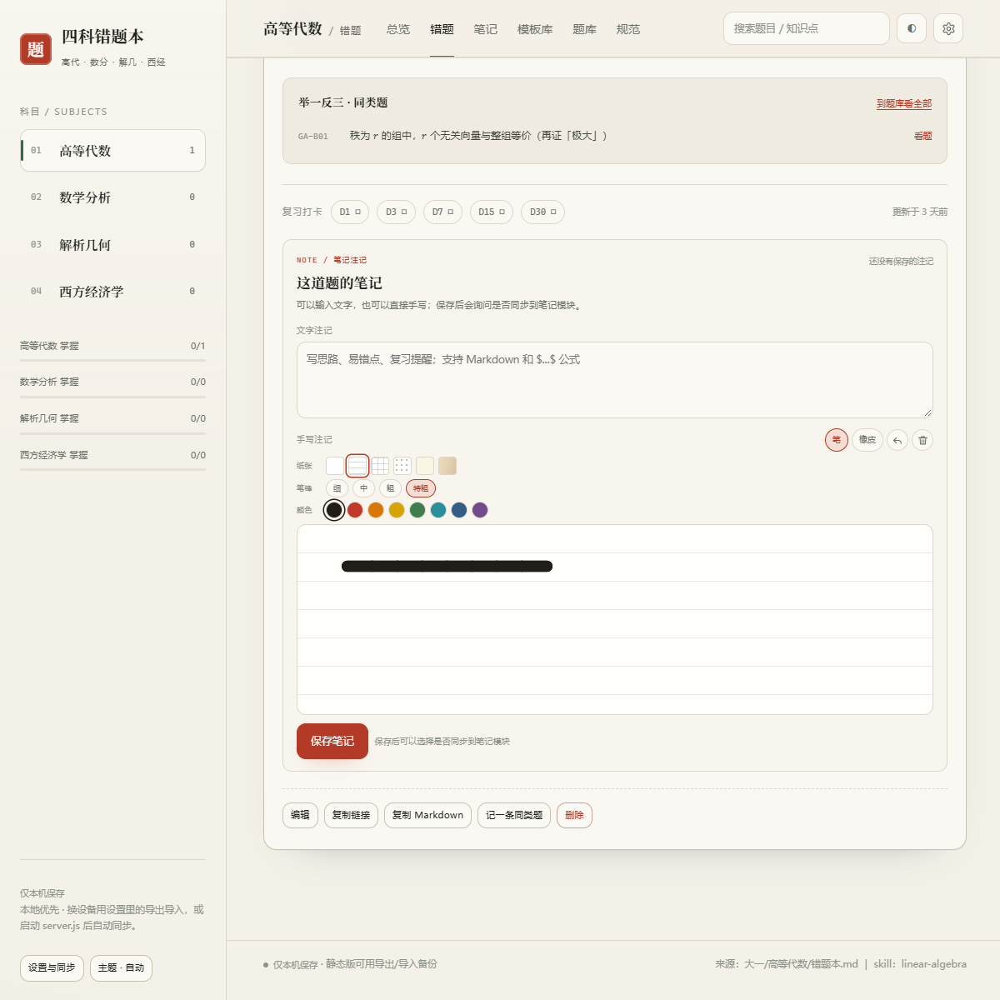

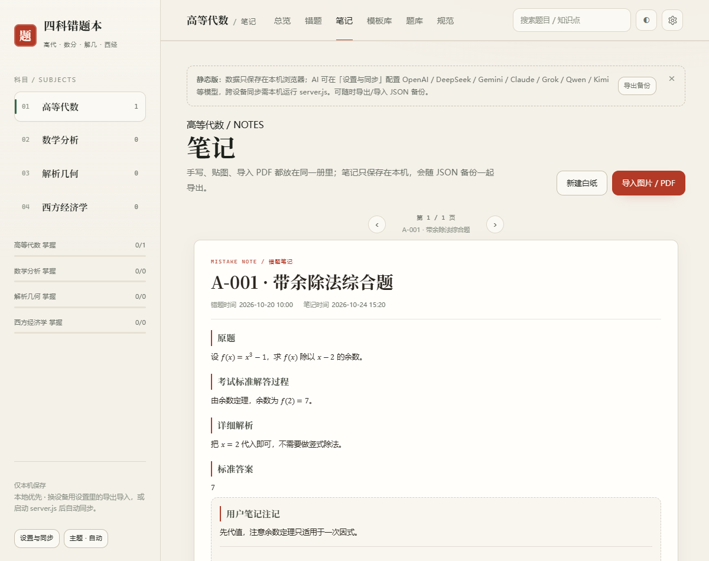

### 5. AI 智能录入

在「设置与同步 → 在线 AI 服务」配置模型后，可以直接输入题目文字，或拍照 / 上传题目图片，让 AI 一次生成：

- **考试标准解答**：按卷面写法整理，步骤完整，可直接对照。
- **详细解析**：切入点、关键一步、定理依据、易错点、验算。
- **答案**：单独成块，方便自测。
- **同类型解答模板**：模板名称 + 识别特征 / 首选方法 / 步骤骨架 / 易错点。
- **1–2 道变式**：用于举一反三。
- 章节、知识要点、难度、错因标签。

手机端图片导入有两个入口：

- **拍照**：直接调用系统相机，拍完即加入。
- **从微信 / 相册选择**：不强制打开相机，可打开系统相册，选择微信聊天里保存到相册的题目图片。微信内会显示「先把图片保存到相册」的导入帮助。

最多 3 张，支持多选、拖拽和粘贴；HEIC 图片若浏览器无法解码，会提示先在相册中导出为 JPG 再试。

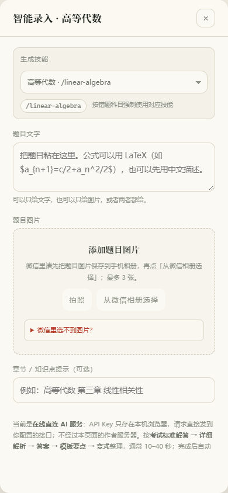

生成完成后会自动入库。若缺少标准解答、详细解析、答案、模板四段或变式，会阻止自动入库并提示重新生成，避免留下半成品。自动入库后仍可编辑校对。

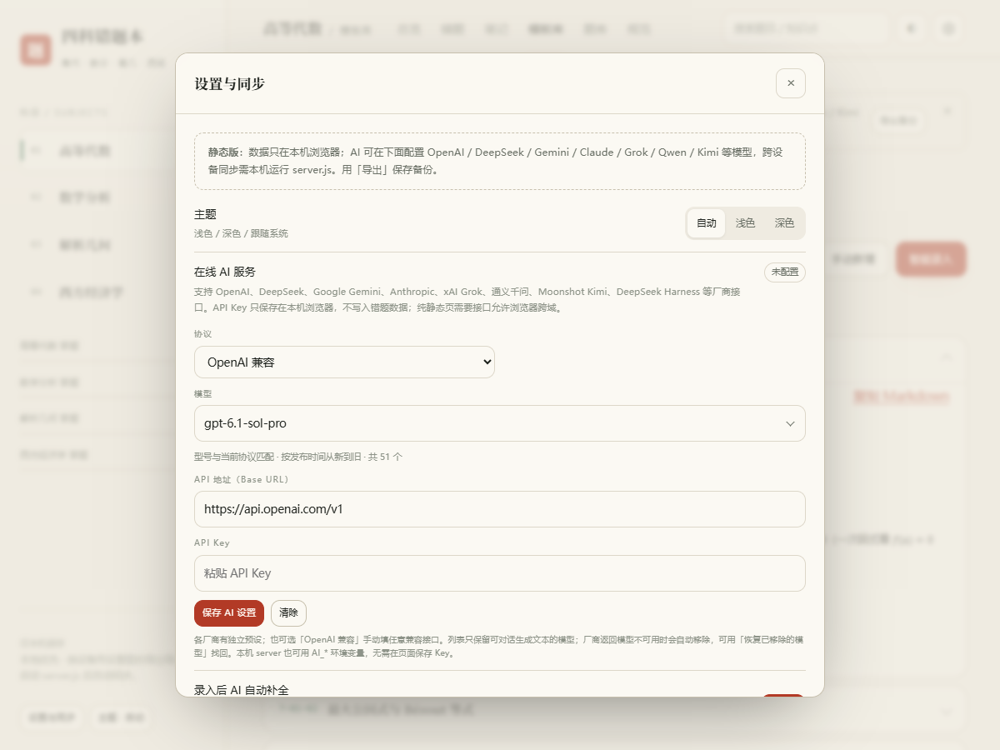

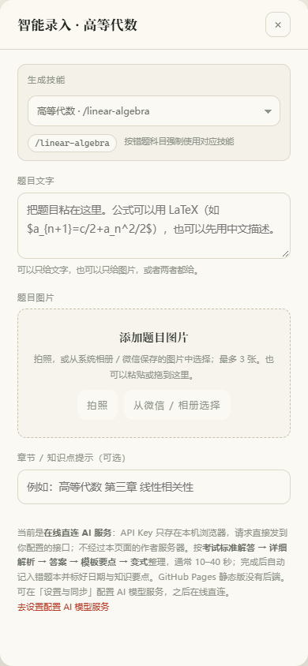

#### 支持的模型服务

页面内置 7 家厂商预设，并保留 DeepSeek Harness：

- OpenAI（及任意 OpenAI 兼容接口）
- DeepSeek
- Anthropic Claude
- Google Gemini
- xAI Grok
- 通义千问
- Moonshot Kimi
- DeepSeek Harness

模型字段是一个可搜索的单框：点箭头展开按发布时间从新到旧排列的列表，输入文字实时筛选，也可以直接输入任意模型名。仅保留可对话生成文本的通用模型（当前 109 个），按厂商归档；图像、语音、嵌入、代码专用和明确不可用的旧模型不再显示。输入与当前协议明显不匹配的型号时，下方会提示检查 Base URL；厂商返回模型不可用时会自动从列表移除并切换到默认模型，可在设置里恢复。

- **纯静态页**：浏览器直接请求你配置的接口，接口需要允许跨域。
- **本机 server**：可通过 /api/solve 代理请求，适合不允许浏览器跨域的接口；也支持服务端环境变量，不把 Key 放进页面。
- API Key 只保存在本机浏览器 localStorage，不写入错题数据或导出文件。
- 题目文字和图片会发送到你选择的模型服务，请注意隐私；不要上传含个人信息的图片。
- 模型输出可能有错，请对照题干、课本和定理依据核对。

### 6. 录入后自动补全

- 新错题保存后进入自动队列，默认约 12 秒后开始，在 10 分钟窗口内补齐解答。
- 状态包括：AI 待补全 / AI 补全中 / 待配置 AI / AI 已补全 / AI 补全失败。
- 可手动「立即补全」「重试」「跳过」。
- 页面关闭后队列保留，下次打开继续；这是纯静态页的限制。需要关页也执行，必须使用常驻 Node 后端。

### 7. 数据、备份与同步

- 数据默认保存在当前浏览器的 localStorage。
- 「设置与同步 → 导出 / 导入」可把全部错题、模板、题库和偏好导出为 JSON，换电脑或清缓存前请先备份。
- 导入时先显示文件名与各科条数，可手动选择「合并到现有数据」（追加新条目；编号冲突先比较内容，相同跳过，不同可重新编号）或「覆盖当前数据」；覆盖前建议先导出当前数据。

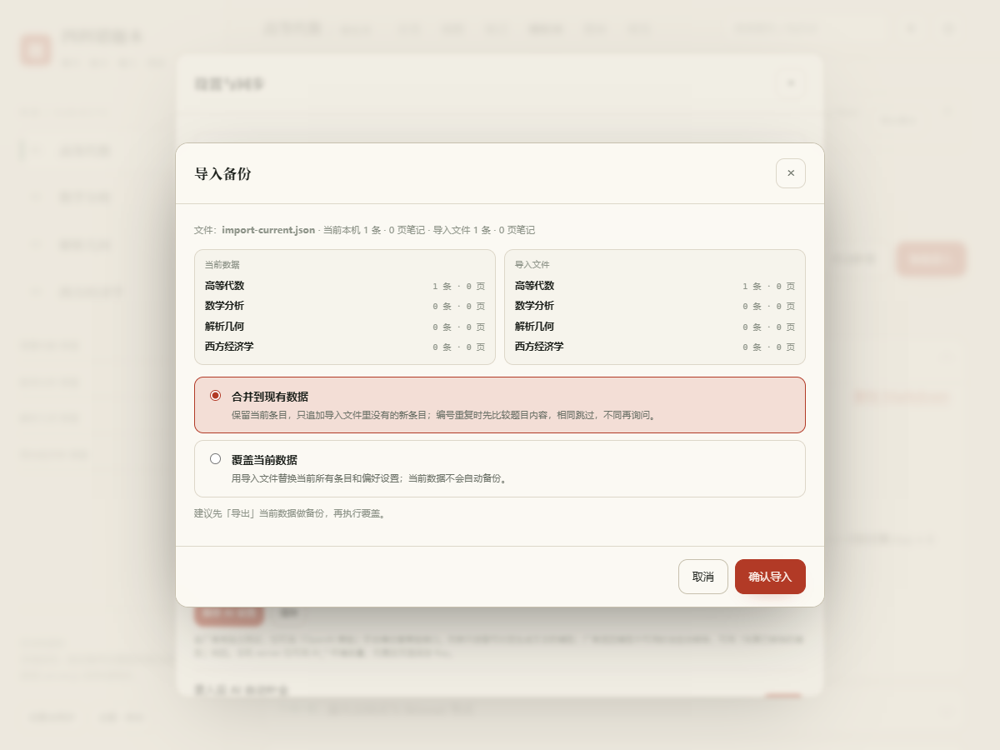

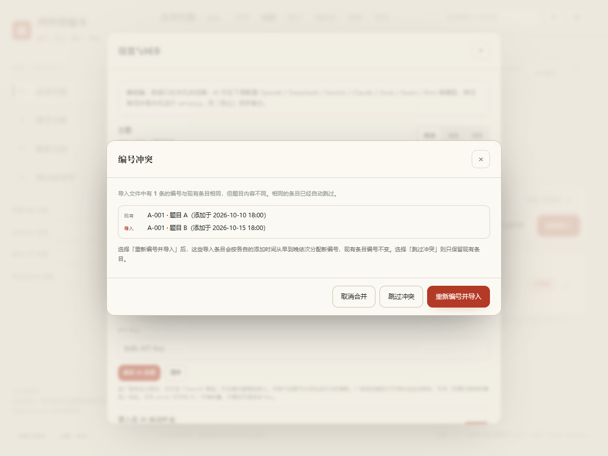
- 纯静态 GitHub Pages 没有跨设备同步。
- 需要跨设备同步时，可在本机运行项目里的 Node 后端 server.js，通过 /api/state 同步；页面会显示「本机服务已连接」。
- 清除浏览器站点数据会丢失本地错题；这不是云笔记，请定期导出。

## 屏幕适配

- 手机 320–430px：顶栏自动分成品牌、科目、标签三行；320px 下科目按钮为 2×2，搜索保留、主题移入设置；设置 / AI / 编辑弹窗全屏，底部按钮避开安全区。
- 平板 / Fold 内屏 600–900px：隐藏侧栏，内容单列，统计卡两列；欢迎页科目卡改为双列并垂直居中。
- Flip 外屏 300–430px：单列紧凑封面，短屏隐藏长介绍与功能标签，减少滚动。
- TriFold / 大 Fold 1000–1200px：侧栏 + 双列首页，正文保持 16px 阅读字号。
- 折叠屏 / 横屏：用安全区留白避开刘海与折角；iPhone Duo（430×932 / 932×430）、iPad mini（744×1133 / 1133×744）、HUAWEI Mate XT（360×800 折叠 / 1008×1280 展开）、OPPO Pad Mini（640×960 / 960×640）、Samsung Galaxy Z Fold8 / Z Flip8 / Z TriFold、OPPO Find N6、HONOR Magic V6 / Magic V Flip2、Xiaomi 18 Fold 均无横向溢出。
- 平板阅读：正文 16px、行高 1.9；901–1080px 窄横屏隐藏面包屑，标签与搜索不拥挤。
- 短横屏（高度 ≤560px）：压缩欢迎页标题与间距，隐藏长介绍，减少滚动。
- 桌面 1440–1920px：正文最大宽度 1280px，避免超宽屏行太长。
- 长表格、长公式在自身容器内横向滑动，不会把整页撑出横向滚动。
- 欢迎页、静态提示条、搜索占位文字会按屏幕宽度缩短。

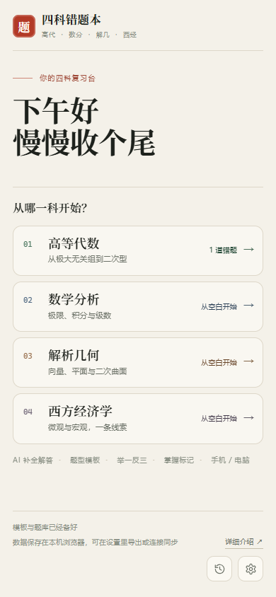

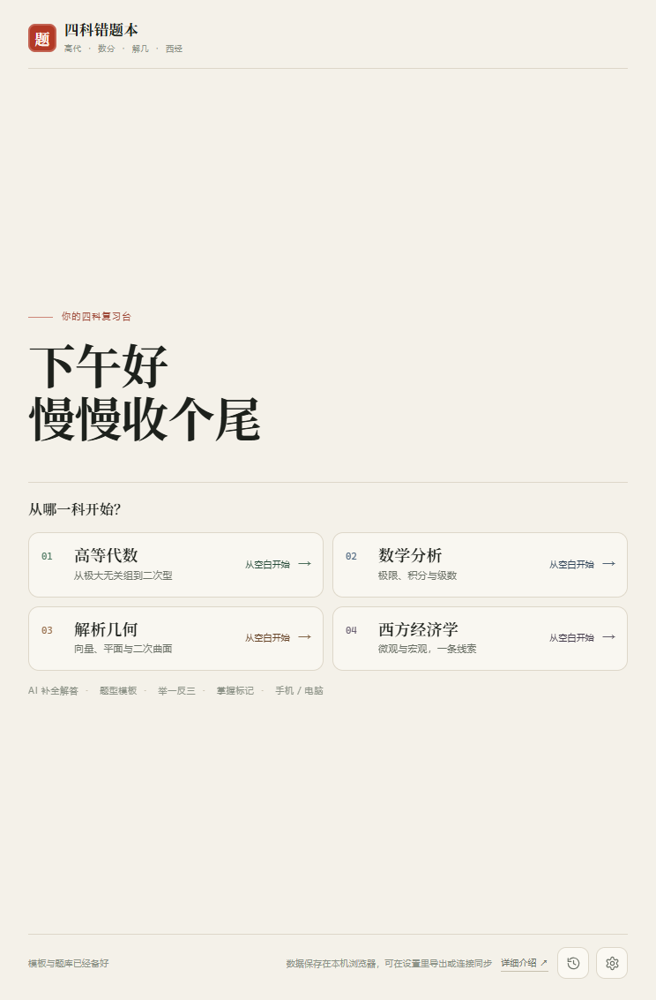

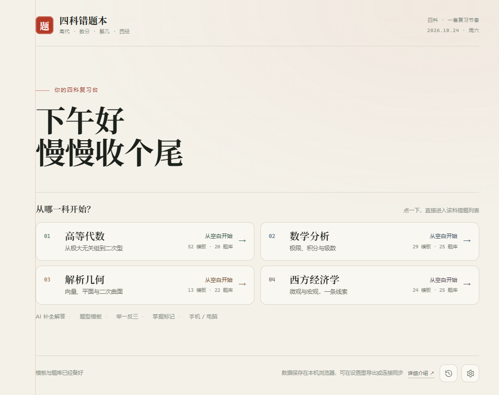

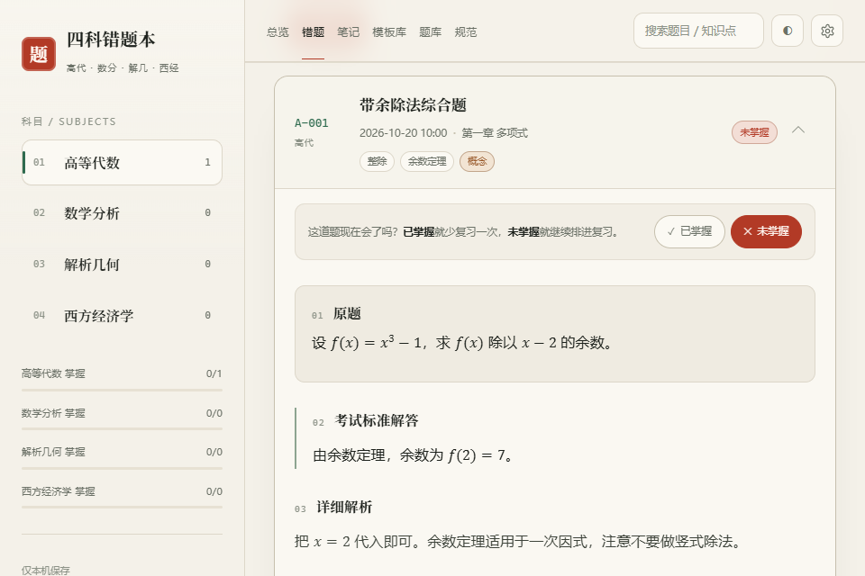

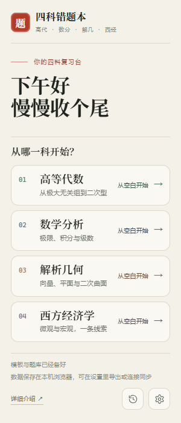


## 使用方式

1. 打开 **https://lanzaihua.github.io/**；首页底部也有「设置与同步」按钮，可直接配置主题、AI 模型、备份与同步。
2. 选择科目，点「手动新增」逐题录入，或点「智能录入」让 AI 生成。
3. 先自己写一遍，再对照标准解答和详细解析。
4. 用「已掌握 / 未掌握」记录复习状态，用题库做变式自测。
5. 定期在「设置与同步」导出备份。

## 本地运行（可选）

如果需要跨设备同步、服务端 AI 代理或局域网访问，可以在本机运行 Node 后端：

```bash
node server.js
```

默认地址为 http://127.0.0.1:4173。手机访问可用：

```bash
node server.js --lan
```

服务端 AI 可通过环境变量配置，例如：

```bash
AI_PROTOCOL=openai \
AI_BASE_URL=https://api.openai.com/v1 \
AI_MODEL=gpt-6.1-sol-pro \
AI_API_KEY=你的Key \
node server.js
```

也支持 DeepSeek Harness 的 DSH_ 开头旧凭据变量；未配置 AI 时，普通错题功能不受影响。

## 隐私与限制

- 不需要注册，没有账号系统，也没有云端用户数据。
- 错题默认只存在当前浏览器；换浏览器、换设备、清缓存不会自动迁移。
- AI Key 只存在浏览器；使用本机 server 时，页面携带的配置会发到你自己的服务端。
- 纯静态页的 AI 直连依赖接口 CORS；被浏览器拦截时请改用本机 server。
- 四科技能材料会以压缩形式内联进静态页，用于拼 system prompt；公开页面在技术上可被解出。若需要严格保护，请使用私有部署或本机 server。
- 历史模型可能已下线；模型列表以厂商接口实际可用性为准，支持手动输入新模型名。
- 页面是学习辅助工具，不保证 AI 解答正确，也不替代教材、老师和考试要求。

## 技术说明

- 单文件静态应用，部署在 GitHub Pages。
- Markdown 由 marked 解析，数学公式由 Temml 渲染。
- 无前端框架运行时依赖，打开 HTML 即可使用。
- 可选 Node 后端负责静态服务、状态同步和 AI 代理。
- 数据格式为浏览器 localStorage 中的 JSON，可通过页面导出 / 导入迁移。

## 反馈

如果发现排版、题目、模板或 AI 生成结果有问题，欢迎在仓库提 Issue，或直接通过页面里的编辑功能修正自己的副本。
