

<h1>四科错题本</h1>

<b>高等代数 · 数学分析 · 解析几何 · 西方经济学</b> 
错题、模板、题库、AI 智能录入、期末复习与单科模拟考、手写笔记和 Markdown 知识笔记，放在一个单文件网页里。

<b>联系</b> <a href="mailto:3554833568@qq.com">3554833568@qq.com</a> · <b>118</b> 解答模板 · <b>9163</b> 道题库 · <b>4</b> 科 · <b>内置中文</b> · <b>0</b> 注册

<a href="https://lanzaihua.github.io/"><b>开始使用</b></a> · <a href="#功能">功能</a> · <a href="#界面">界面</a> · <a href="#更新记录">更新记录</a> · <a href="#隐私与限制">隐私与限制</a>

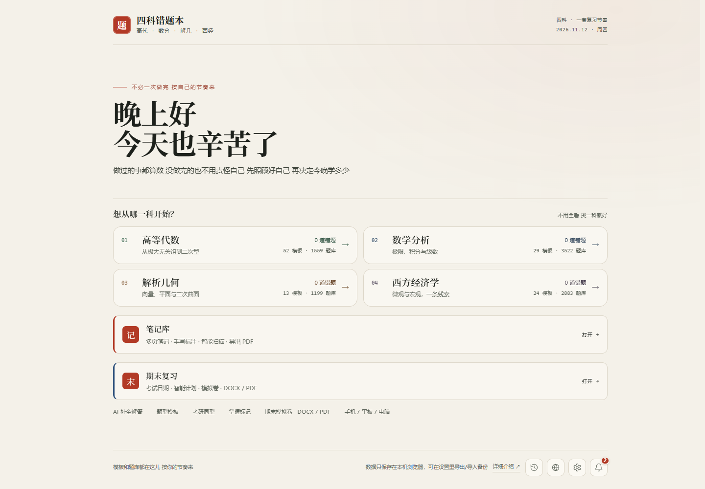

> 一个单文件学习工作台。错题、解答模板、考研同型题库、AI 智能录入和笔记共享同一套编号与复习节奏；数据默认只留在本机。

## 快速开始

1. 打开 <https://lanzaihua.github.io/>。
2. 选择一科，手动新增错题，或者把题目交给 AI 智能录入。
3. 先自己做一遍，再对照标准解答、详细解析和模板；用题库做同类型变式。

| 适合 | 现在包含 | 数据方式 |
|---|---|---|
| 大学高代、数分、解几、西经的错题整理与考前复习 | **118** 张解答模板 · **8350** 道考研同型题 + **590** 道教材课后习题 + **223** 道习题集题 · 统一笔记库 | 默认 localStorage；可导出 / 导入 JSON 备份 |

## 四个科目

| 科目 | 主要内容 | 模板 | 题库 |
|---|---|---:|---:|
| 高等代数 | 行列式、矩阵、线性方程组、向量空间、线性变换、特征值、二次型、欧氏空间 | 52 | 1559 |
| 数学分析 | 极限、连续、导数、积分、级数、多元微积分、曲线曲面积分 | 29 | 3522 |
| 解析几何 | 向量与坐标、平面与空间直线、柱面锥面旋转曲面、二次曲线与二次曲面 | 13 | 1199 |
| 西方经济学 | 供求、弹性、消费者、生产者、成本、市场结构、市场失灵、GDP、IS-LM、AD-AS、失业、通胀、增长 | 24 | 2883 |
| **合计** | | **118** | **9163** |

四科分开建册。每科有自己的编号、章节、模板和题库，互不混淆。

## 功能

### 错题记录

- 册内唯一编号：高代 <code>A-001</code>、数分 <code>M-001</code>、解几 <code>G-001</code>、西经 <code>E-001</code>。
- 记录原题、考试标准解答、详细解析、答案、模板、章节、知识要点、难度和错因。
- 已掌握 / 未掌握状态会同步到首页和科目页统计。
- 支持关键词、章节、模板、难度、状态筛选，以及编辑、删除和展开阅读。

### 模板与题库

- 118 张模板按科目和章节组织，顶部章节目录可直接跳转。
- 模板固定四段：识别特征 / 首选方法 / 步骤骨架 / 易错点。
- 8350 道考研同型题 + 590 道教材课后习题 + 223 道习题集题，可以展开查看标准解答、详细解析、答案、解题要点和易错点。
- 模板、题库、错题条目都支持复制 Markdown 源码；题库由 8350 道考研同型题、590 道教材课后题与 223 道习题集题组成。基础 8250 道按每章 1–5★ 各 10 客观 + 10 填空 + 10 主观配置，教材 590 道为补充、不占该配额。

### 统一笔记库

- **手写笔记本**：笔、荧光笔、橡皮、直线、套索；10 种纸张；多页；插入文字和图片。
- **知识笔记**：Markdown、<code>[[双链]]</code>、反向链接、标签、全文搜索和关系图谱。
- **统一入口**：全部 / 笔记本 / 知识笔记切换，共用同一个搜索框。
- **智能扫描**：自动裁边、滤镜、旋转、连续扫描多页、OCR，保存后可导出 PDF。
- **导入导出**：图片、PDF 转页面；PNG / PDF 导出；数据随 JSON 备份。

### AI 智能录入

配置模型后，可以输入文字或上传题目图片，让 AI 一次生成考试标准解答、详细解析、答案、模板四段和 1–2 道变式。

- 支持 OpenAI 兼容接口、DeepSeek / DeepSeek Harness、Claude、Gemini、Grok、通义千问、Moonshot Kimi。
- 可选错解诊断：先指出错在哪一步、真正卡点、怎么改、下次怎么防，再给标准解答。
- DeepSeek 峰谷提示按官方规则：工作日 09:00–12:00、14:00–18:00 为峰时，周末和法定节假日全天谷时。
- 峰时可先暂存题目和图片，谷时再送入生成；暂存只存在本机。
- 新错题可自动进入补全队列；页面关闭后队列保留，下次打开继续。

### 期末复习

- 设定考试日期和时长，自动拆成基础回顾、强化训练、冲刺模拟三段，并排进每日任务。
- 错题和题库题可加入期末材料；模拟卷按时长和章节选题，分值按题型和难度智能分配（客观题单题不超过 7 分，主观题按难度加权，总分 100），可手动修改。
- 卷子可在线改题、改答案、改分值、调顺序、补题或删题。
- AI 批改的错误点、要点、易错点和用户作答统一按 Markdown + LaTeX 渲染；加入错题时保留完整选项、用户错选、作答与卡点，不再出现原始 $$...$$。手写图片以白底 PNG 随题发送并要求 AI 先转写再批改，未识别时保守复核。
- 导出 DOCX，或打开打印窗口另存为 PDF。

### 文案原则

- **学术与题目文本**：题目、证明、解答、解析、模板和知识要点使用正式、准确、克制的学术书面语；术语按目标语言教材与期刊惯例，不用网络口语、卖萌、感叹号或表情。
- **欢迎、提醒与询问**：欢迎、引导、提醒、确认和空状态使用温和、亲切、具体的第二人称；不命令、不责备、不夸张承诺。
- **多语言语气一致**：界面翻译与 AI 生成使用同一套语气规则；翻译缓存升级到 v11 后重新生成。

### 数据、备份与语言

- 数据默认只在本机浏览器；换设备或清缓存前请先导出备份。
- JSON 备份默认只含用户错题、用户自建模板/题库、笔记和设置；内置 9163 道题库与 118 张模板由页面自带，不写入备份，导入也不会回滚内置题库。支持合并或覆盖导入。
- 当前语言备份会预翻译内容并输出 gzip 压缩的 <code>.json.gz</code>，文件更小。
- 界面内置简体中文；繁體中文部分内置；English、Français、Deutsch、日本語、한국어、Português、Русский、Español 需要在设置里配置 AI 后生成并缓存，未配置时仍可正常使用简体中文。
- 语言选择持久化；界面、题库、规范、笔记和弹窗使用同一套翻译缓存（v11）。
- 单文件页面首次打开需要联网加载；首次成功打开后，浏览器会注册离线缓存，断网刷新可回到最近一次成功页面，数据仍只在本机。

## 界面

总览 · 笔记库 · 模板库 · 规范

<table>
<tr>
<td width="50%">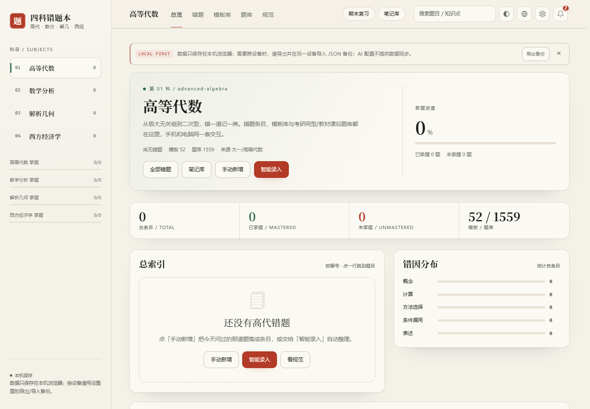 <b>总览</b> · 章节、掌握进度与错因分布</td>
<td width="50%">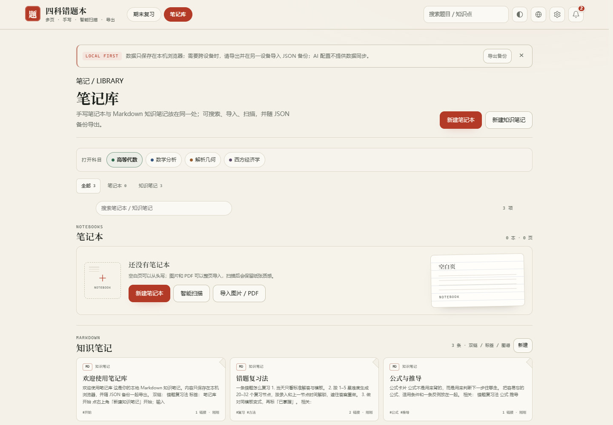 <b>笔记库</b> · 手写笔记本与 Markdown 知识笔记</td>
</tr>
<tr>
<td width="50%">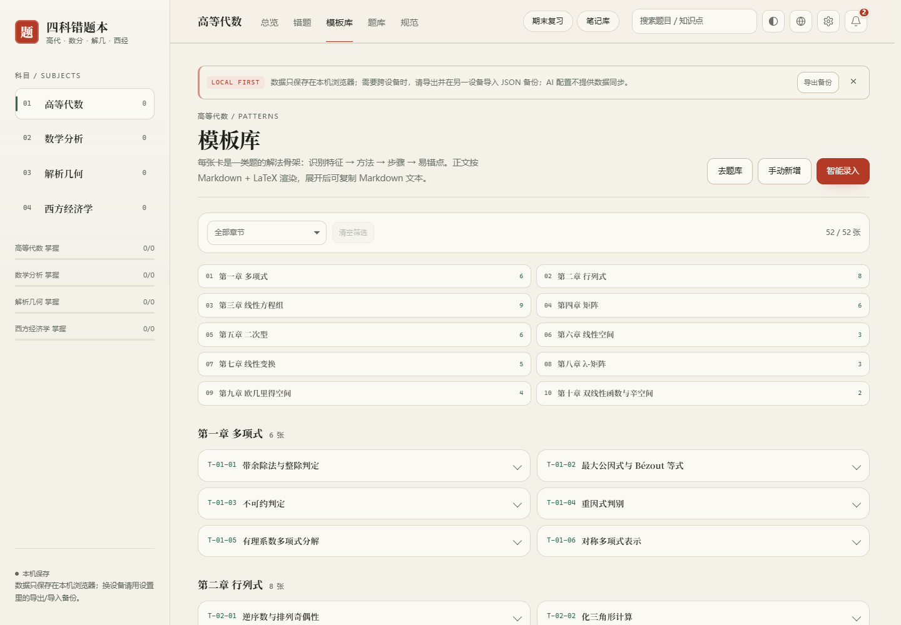 <b>模板库</b> · 章节索引与双列卡片</td>
<td width="50%">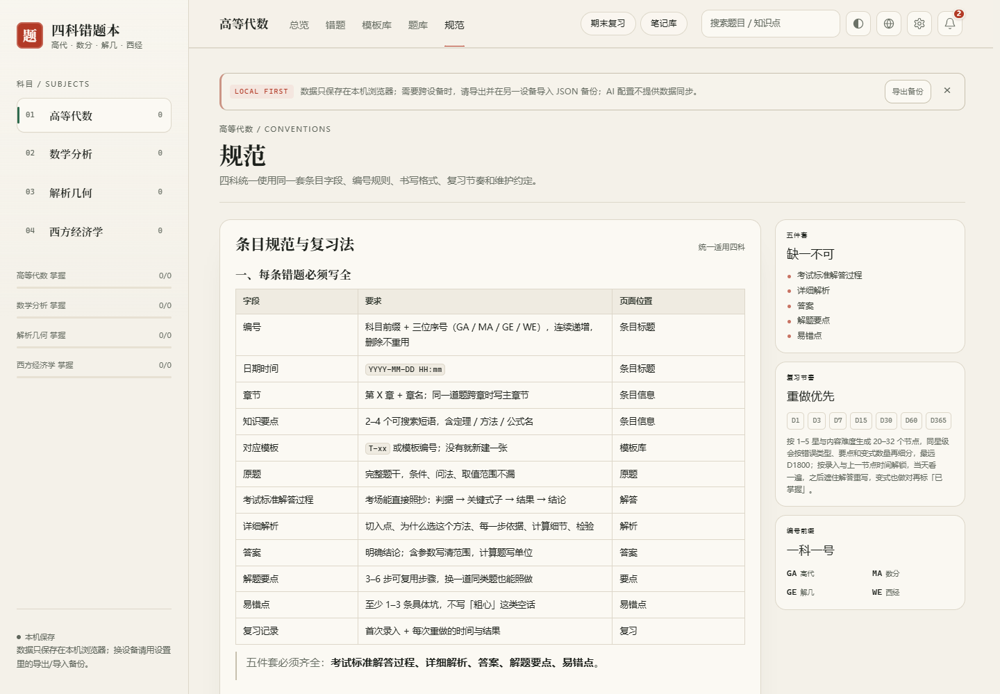 <b>规范</b> · 五件套、编号与复习节奏</td>
</tr>
</table>

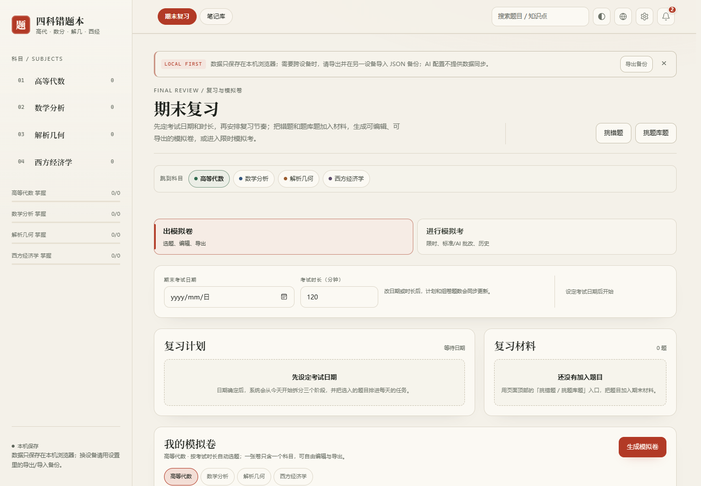 <b>期末复习</b> · 复习计划、模拟卷与限时模拟考

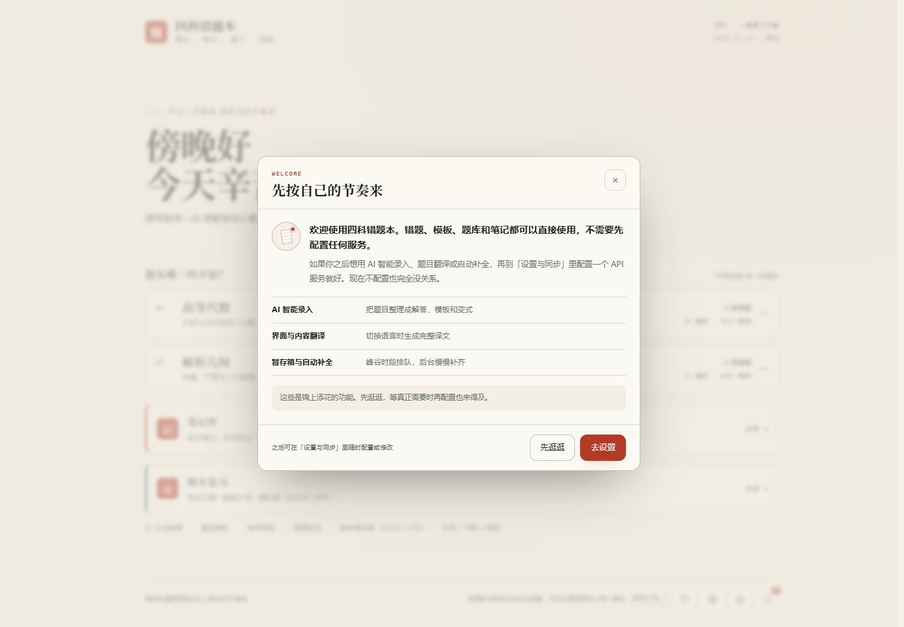 <b>首次进入</b> · 未配置 AI 时的一次温和提醒

## 屏幕适配

| 设备 | 视口 | 处理 |
|---|---|---|
| 手机 | 390 × 844 | 单列内容，操作按钮可横向滚动，弹窗内部滚动 |
| 平板竖屏 | 834 × 1112 | 隐藏侧栏，设置弹窗 780 宽，更新记录两列 |
| 平板横屏 | 1112 × 834 | 设置弹窗 860 宽，更新记录两列 |
| 电脑 | 1440 × 1000 | 正文限宽，设置弹窗 860 宽，更新记录 860 / 两列 |

长表格、长公式在自身容器内横向滑动，不会把整页撑出横向滚动。

<b>适配验证命令</b>

    npm i -D playwright-core
    node tools/qa-responsive.js

检查范围：首页、总览、错题、模板库、题库、规范、笔记、设置、更新记录，以及横向溢出、弹窗高度和分栏。

## 更新记录

### 2026-11-12 · 错题小节与习题集入库

**5 项 · 5 组**

在 11-12 已完成的错题小节筛选基础上，本轮把西经配套章节题库的 223 道可复核题录入题库，新增「习题集」来源筛选与卡片标签；四科总数 9163（1559 / 3522 / 1199 / 2883），来源分布 8350 考研同型、590 教材课后、223 习题集；同步 build、QA、审计、站点一致性与 README 计数。本块 5 项 / 5 组，66 项测试、严格 QA、站点一致性与 390 / 820 / 1440 检查通过。

| 分组 | 本次更新 |
|---|---|
| **错题小节** | 错题筛选工具栏在章选择后保留小节下拉：选定大章才出现，只列出当前章确实有题的小节；换章自动回到全部小节，清空筛选时一并恢复；筛选计数、空态与手机、平板、桌面布局同步更新。 |
| **习题集入库** | 西经配套章节题库新增 223 道可复核题：131 道选择（概念辨析题）与 92 道判断填空（概念辨析题），编号 WE-9101–WE-9323，覆盖 16 章，答案与解析来自原书；题干、标准解答、详细解析、答案、要点、易错点与小节字段均已补齐。 |
| **来源筛选** | 题库来源栏新增「习题集」，与「全部来源 / 考研同型 / 教材课后」并列；卡片标签同步显示习题集，来源键分为 exam / textbook / exercise 三类，筛选仍按章→小节级联。 |
| **计数同步** | 四科 1559 / 3522 / 1199 / 2883，总数 9163（8350 考研同型 + 590 教材课后 + 223 习题集）；build、严格 QA、Python 审计、站点一致性、回归测试与 README 计数同步更新。 |
| **质量门禁** | 来源白名单与来源正则加入「习题集」，只有考研同型题才强制要求「真题」来源标记；新增题继续通过 55 章、825 桶每桶 ≥10、十类题型、四选项唯一与主观题解答开头检查。 |

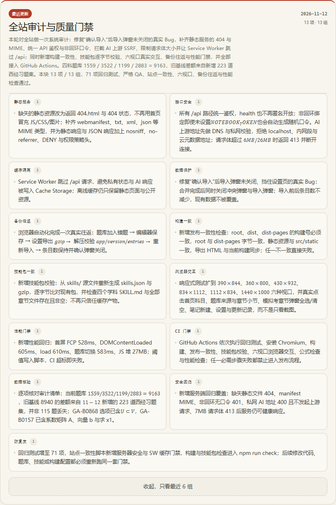

### 2026-11-11 · 题库扩充与小节筛选

**24 项 · 24 组**

本轮在原有真实进度、公式与习题修复的基础上，给题库补了章下小节：四科 55 章共 343 个小节写入章节目录，题库、模板库、模拟考章节弹窗与期末复习的章选择都改为先选大章、再选小节，只展示当前章里确实有题的小节。题库新增 109 道可复核题目：西经 100 道配套题库单项选择题（WE-9001–WE-9100，答案与解析来自原书）与高代 9 道行列式教材题（GA-9001–GA-9009），总数 8940（1559 / 3522 / 1199 / 2660），教材课后 590。QA 与构建的配额从精确相等改为下限，避免新增题目被旧总数误判；本块 24 项 / 24 组，66 项测试、严格 QA、站点一致性与 390 / 820 / 1440 检查通过。

| 分组 | 本次更新 |
|---|---|
| **流式返回** | AI 请求默认走流式返回，兼容 OpenAI 的 choices[0].delta.content 与 Anthropic 的 content block delta；收到首个字节即回调，正文按块累计；服务端返回普通 JSON 时自动回退，流式结束却没有正文则按空响应报错，不再静默等待整包。 |
| **字段进度** | 智能录入按 21 个 JSON 字段的真实出现顺序计算：每多一个字段就前进一步，最后一个字段按已收到的正文字符数估算进度，区间 8–88%；文案显示「已收到 5 / 21 字段 · 27%」，解析、写入与完成阶段分别推进到 90%、96%、100%。 |
| **出题计数** | AI 出题读取流式正文里的 questions 数组，每出现一道完整题目就累加，正在生成的那道题按已收到字符折算，区间 5–87%；文案显示「已收到 X / N 题」，批次结束、合并去重与组卷校验分别推进到 92%、96%、100%。 |
| **批改计数** | AI 批改读取逐题批改对象，按已核对题数从 70% 推进到 97%，再进入生成结果；等待首批返回时停在 5–70% 的真实阶段，不提前跑满，也不在模型返回后停在固定百分比。 |
| **OCR 字数** | 扫描识别按画布像素估算本页预期字数，再按流式返回的实际识别字数从 8% 推进到 94%，文案显示「已识别 X 字」；服务端 OCR 仍是非流式接口，这一路径会停在 8% 直到返回，属于已注明的接口边界。 |
| **自动整理** | 自动整理、知识点 AI 搜索与自动补全接入同一条流式通道：首个字节 8%，之后按标题、正文、书章、标签等字段推进到 85%，返回后 90%，写入完成才 100%。 |
| **同源百分比** | 进度条填充宽度、右侧百分比文字和 aria-valuenow 都由同一个四舍五入后的整数生成，不再出现宽度 11.8%、文字 12% 的错位；进度只增不减，倒退值会被夹住，完成后显式写 100%。 |
| **防复发** | 新增流式字段统计、题目数组计数、百分比宽度同源、倒退夹住、取消与空响应回归测试，测试总数 66；390 / 820 / 1440 在进度中段抓取到 6% → 12% → 27% → 39% 的连续状态，宽度、文字与 aria 完全一致，无横向溢出、无脚本错误。 |
| **公式基线** | 修复 MathML 行内公式被按整块宽度布局的问题：数学元素的显示值改为 inline math，普通公式共用正文行高与基线，矩阵、分式、上下标不再把标点挤到单独一行；只有超宽公式保留横向滚动。 |
| **转义美元** | 模型写成反斜杠美元符的成对公式现在还原为普通公式；cases、pmatrix 等环境内部的误加美元符先清理；真正的货币写法仍按字面美元显示，不再出现 $ 泄漏或整段 LaTeX 原样输出。 |
| **题库反斜杠** | 修复高代第六章 GA-B0868 / GA-B0869 / GA-B0870 中缺失反斜杠的 LaTeX 命令（U\subset V、v\in V、V=\mathbb{R}^2），题库、模拟考与错题页不再显示 Usubset、mathbb 等裸命令。 |
| **英文词组** | 知识点解析里的英文术语（如 one-sided derivative）不再被裸公式扫描器包成公式，连字符不会被排成减号、单词也不会变成斜体。 |
| **数据门禁** | QA 与构建新增缺失反斜杠命令检查，纯英文词组、数学定界符、公式宽度与基线继续由回归测试覆盖，测试总数 66，防止同类问题再次进入页面。 |
| **矩阵语言** | 题库中 599 处矩阵题干补上矩阵名：设$...$ 改为 设$A=...$，其中$...$ 改为 其中系数矩阵$A=...$，句号后的「矩阵的秩 / 特征值 / 行列式 / 余式」改为逗号加「求…」，不再出现「设 [矩阵]。矩阵的秩…」这种断句。QA 与构建新增永久门禁，缺少矩阵名或句号接问句直接失败。 |
| **习题集索引** | 两个学科 skill 增加习题集来源：advanced-algebra 增加《高等代数习题精选精解》的章/节地图与题型方法索引，mathematical-analysis 增加吉米多维奇 6 卷 1,401 页的卷/页地图与题型索引；两处都注明原书是图片扫描，OCR 只用于定位，不声称收录全部原题。 |
| **习题入库** | 题库本轮新增 115 道可复核题目：高代 GA-TX048/049/050、GA-9001–GA-9009 行列式教材题，数分 MA-TX070/071/072，西经 WE-9001–WE-9100 配套题库单项选择题；总数 8940（1559 / 3522 / 1199 / 2660），教材课后 590，新题字段、解答开头、四选项唯一与分类都过严格 QA。 |
| **小节目录** | 按四本教材目录建立章下小节表：高代 10 章 72 节、数分 23 章 81 节、解几 6 章 44 节、西经 16 章 146 节，共 55 章 343 节；每章保留「综合与其他」兜底，小节名去掉星级与反引号后展示。 |
| **小节联动** | 题库、模板库、模拟考章节弹窗与期末复习的章选择改为级联：只有选定大章后才出现小节下拉或小节勾选，且只列出当前章确实有题的小节；换大章会重置小节，计数与空态同步更新，手机、平板、桌面都不溢出。 |
| **题库扩充** | 西经从配套题库的章节单项选择题中清洗出 100 道（WE-9001–WE-9100，覆盖 16 章，保留原答案与解析）；高代从第二章行列式习题解答中复核 9 道主观题（GA-9001–GA-9009，含克拉默法则、插值多项式与范德蒙德型行列式），题干、解答、考点与易错点均为标准字段。 |
| **配额下限** | 严格 QA、构建、站点一致性与 Python 审计从「正好等于旧总数 / 每桶正好 10 / 每章分类正好 15」改为下限校验：新增题目不会再被旧配额误判为失败，但总数、分科数、每桶 10 题与十类题型的最低覆盖仍会拦截。 |
| **仓库重排** | README 把「源码、构建与开源」整段移到「技术说明」之后、「反馈」之前；当前计数改为 590 道教材课后与 8940 总数，源码包与 SHA256SUMS 链接改到 v2026.11.11，首页与界面截图统一到 20261111，回归测试数改为 66。 |
| **触控尺寸** | 导航交叉入口「期末复习 / 笔记库」在桌面至少 34px、平板 38px、手机 40px；「查看本科规范与示范」链接操作 34 / 40px；弹窗标题栏关闭键与通知关闭键 34 / 40px。 |
| **辅助字号** | LOCAL FIRST 提示标签、模板章节序号与计数、规范页 D1/3/7/15/30 标签统一到 10px；MathML 上下标仍由公式排版决定，不按正文小字放大。 |
| **记录核对** | 逐块核对 20 个日期的更新记录与构建日：11-11 只保留一块，不新增同日第二块；11-10 及更早历史块保持当天状态，不改写为今天的计数；GitHub Releases 每日期仍只有一条。 |

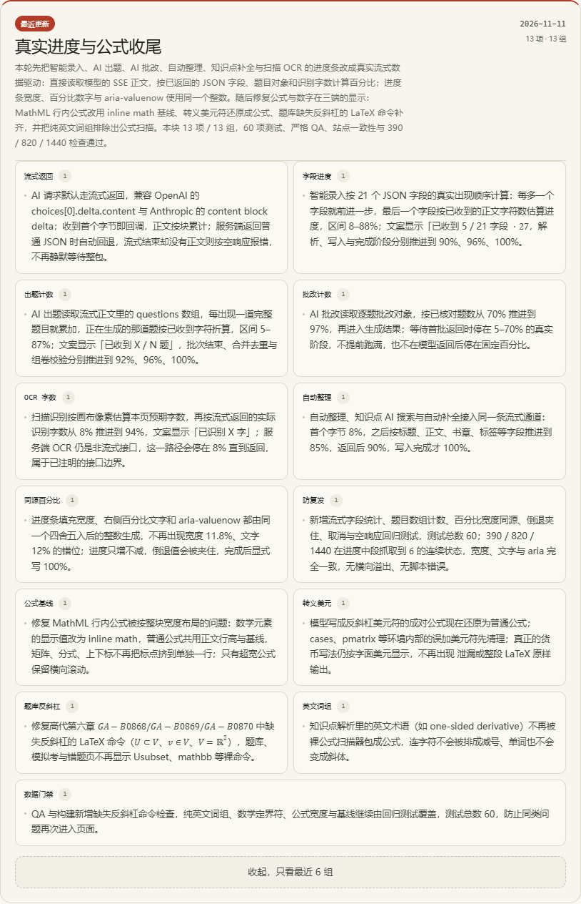

### 2026-11-10 · 界面回退与三端收口

**22 项 · 22 组**

本轮把全站配色与版式恢复为 2026.11.10-2ea474da：暖米色纸面、砖红强调、巨型衬线问候、英文大写小标签、卡片和装饰阴影回到原样，首页恢复按小时变化的问候和用户称呼，欢迎弹窗恢复原有文字、图标、按钮与卡片；同时保留错题智能录入、AI 出题、AI 批改、笔记导入导出、扫描 OCR 等长任务的真实阶段、真实计数与真实等待时间，并收口三端触控尺寸、辅助字号与深夜科目指引。本块累计 22 项 / 22 组，57 项测试、严格 QA、站点一致性与 390 / 820 / 1440 检查通过。

| 分组 | 本次更新 |
|---|---|
| **规范表格** | 修复规范页表格被拆错行：裸公式扫描器把单元格之间的管道符和「2–4」当成公式，导致「条目信息」挤进要求列、页面位置列空白；表格行现在完整交给 Markdown 表格渲染，三列对齐，单元格内公式仍按行内公式处理。 |
| **手机顶栏** | 手机与平板上的科目顶栏不再整块吸顶：品牌、搜索、科目切换、页签和期末/笔记库入口随页面滚走，阅读题目时不再被 150–234px 高的顶栏挡住；桌面端仍保留吸顶导航。 |
| **通知要点** | 更新通知的计数从「3 项」改为「3 条要点」，与正文的 28 项 / 28 组区分开；通知签名纳入 notifyItems，同一天只改某组文字也会补发一条新通知，旧组不会重复；快照只在通知真正发出后保存，刷新页面不会重发旧内容。 |
| **期末收口** | 期末复习首屏不再重复显示考试日期、时长和复习材料数，这些信息只留在设置表单与复习材料面板；复习材料空态不再重复顶部「挑错题 / 挑题库题」入口；未设日期时不再留下孤立的破折号。 |
| **设置文案** | 设置里的「当前规模」改为「当前科目规模」，避免被当成全站总量，并移除容易被误读为产品版本的 v1 标签；首次欢迎语改为「欢迎使用四科错题本」。 |
| **触控可读** | 手机端顶栏与页脚图标统一到 40×40px，平板与桌面保持 36px；清空筛选、期末科目、科目跳转与模板复制按钮至少 34–40px，次级操作按钮统一 34px，不再出现 25–32px 的小点击区域；品牌副标题、页脚小标签与状态说明提升到 10.5–11px。 |
| **题库卡片** | 题库卡片标题已含「客观题 / 填空题 / 主观题」时，右侧不再重复同一枚题型标签；标题缺少题型时仍保留标签，筛选与题目类型不受影响。 |
| **记录校准** | 修正 11-02 更新记录中的退格损坏字符，把解析几何的旧计数改为 900、「2751 题」改为 2750 题，与同块 8250 = 1500 + 3450 + 900 + 2400 对齐；改写 README 的 11-08 说明，删去「57 项块只展示 30 项、删除可访问性组」的矛盾表述。 README 的「源码结构」「仓库语言与工具链」「源码、构建与开源」三块合并为一节「源码、构建与开源」，去掉重复的许可证、构建与本机运行说明。 |
| **Release 归并** | GitHub Releases 同一日期只保留一整块，标签统一为纯日期：11-09 为 v2026.11.09、11-08 为 v2026.11.08、10-25 为 v2026.10.25；带 -2…-10 等后缀的 release 与标签已清理，不再出现在 Releases 页。 |
| **防复发** | 新增表格管道符、通知签名、配色与问候、期末重复摘要、手机顶栏与三端布局回归测试；严格 QA、站点一致性与 390 / 820 / 1440 检查同时执行，防止同类问题再次出现。 |
| **配色回退** | 按 2026.11.10-2ea474da 恢复全站暖米色纸面、砖红强调、卡片阴影与装饰层级；冷纸色、深墨绿强调、无衬线标题和去阴影覆盖层全部移除。 |
| **问候恢复** | 首页恢复按小时变化的问候与用户称呼：凌晨、早上、上午、中午、下午、傍晚、晚上、深夜八段文案各自不同，标题不再固定；设置里填写称呼后直接显示在问候里。 |
| **欢迎页恢复** | 欢迎弹窗恢复原有暖色样式、圆形印章图标、服务列表卡片、说明文字和「先逛逛 / 去设置」按钮，不再使用冷色版式与英文标签。 |
| **图标恢复** | 品牌标记、页脚工具、通知铃铛、关闭按钮等图标及强调色、状态色全部回到 2ea 的暖色体系；冷色描边与墨绿选中态不再出现。 |
| **三端复查** | 390 / 820 / 1440 复查首页问候、欢迎弹窗、错题、题库、模板、规范、笔记、期末与更新记录：暖色样式一致，无横向溢出、无脚本错误，真实进度条保持原功能。 |
| **深夜文案** | 首页科目入口标题随小时切换：23:00–05:00 显示「明天想从哪一科继续？」，白天保持「想从哪一科开始？」；深夜不再一边劝休息一边催现在开始。 |
| **字号层级** | 统一三端辅助字号：品牌副标题 10.5px，首页提示与计数、筛选计数、科目跳转标签 11px，通知角标 10px，笔记分区标签 10px，避免 8.5–9.5px 的不可读小字。 |
| **期末指引** | 期末复习材料空态把「页面右上方」改为「页面顶部」，与手机端顶部入口一致，不再用桌面方向误导手机用户。 |
| **真实进度** | 错题智能录入、AI 出题、AI 批改、笔记导入导出与扫描 OCR 的长任务卡改为真实数据驱动：有总量时显示已完成 / 总数，没有总量时只显示活动条，不再按固定阶段编造 33%、67% 等假百分比。 |
| **实时等待** | 等待时间从请求发出开始累计，每 250 毫秒刷新到十分之一秒（如「已等待 5.2 秒」）；活动圆点持续呼吸，阶段名与当前说明随真实回调切换，界面不会停在静止的加载文案上。同一天补充通知的标题时间也改按本机时区显示，不再出现 UTC 时间。 |
| **逐题推进** | AI 出题按每批返回的题目数累加，显示「已生成 6 / 27 题」并继续请求下一批；AI 批改在模型返回后按题逐条核对并让出渲染帧，进度条与阶段文字随真实核对进度更新，完成后才切到结果页。 |
| **进度门禁** | 新增长任务进度回归测试：禁止固定百分比、要求秒数精确到 0.1 秒、完成必须显式标记、取消后浮层消失；三端 390 / 820 / 1440 复查进度面板不溢出、不遮挡取消按钮，测试总数增至 57。 |

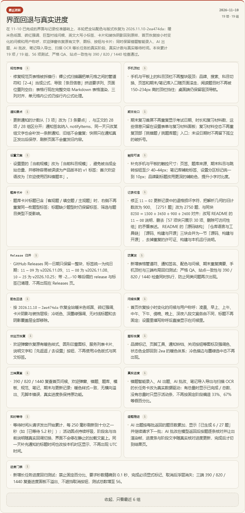

### 2026-11-09 · 长任务、公式与语言

**28 项 · 28 组**

在原有通知、模拟考、长任务与筛选基础上，本轮继续修复公式与数字排版，并把仓库语言统计从单一生成文件恢复到源码：把 15MB 单文件标记为 linguist-generated，新增可运行的 Python 审计/打包、Shell 全量检查、Makefile 入口与语言门禁。本块共 28 项 / 28 组，51 项测试、严格 QA、站点一致性与三端检查通过。

| 分组 | 本次更新 |
|---|---|
| **一键已读** | 通知面板工具栏把「一键清空」换成「一键已读」：只把所有未读标为已读，不删除任何通知；全部已读后按钮自动禁用，显示“没有未读通知”。 |
| **角标定位** | 修复手机、平板与电脑首页右上角出现孤立红色数字：通知按钮重新作为角标定位基准，角标回到铃铛右上角，不再相对整页定位。 |
| **更新排版** | 更新通知展开后改为日期/标题、摘要、分组卡片三层：每条更新有编号、分组名和正文，长文不再挤成一整段；列表只显示摘要或首条，展开才看全文；标题不再经公式渲染，保留「·」两侧空格。 |
| **守则重复** | 标准题库选完章节后不再先弹考生守则，直接进入「题目已准备」页；点「开始模拟考」时只弹一次守则，勾选同意后才开考。 |
| **守则文案** | 标准题库考生守则首句改为本地标准答案批改，不再写「AI 智能批改」；注明不识别手写，手写答案可能按 0 分保守处理，结果页保留标准解答与要点。 |
| **长任务进度** | 新增统一的右下角长任务进度卡：标题、已等待秒数、阶段列表、真实进度与计数；完成、失败、取消都会切换按钮与状态，不确定总量时只显示活动条，不编百分比。 |
| **智能录入** | 错题智能录入按「整理题目 → 请求 AI → 写入条目 → 完成」4 阶段推进，显示阶段 N / 4 与真实等待时长，不再只显示一句笼统的正在生成。 |
| **出题与批改** | AI 出题按已生成题数 / 总题数推进；AI 批改按「读取答卷 → AI 批改 → 逐题核对 → 生成结果」4 阶段推进，显示阶段 N / 4 与当前处理说明。 |
| **笔记导入导出** | 笔记库 PDF 导入逐页、文件导入逐文件、批量导出逐页、扫描保存逐页显示已完成 / 总数；不知道总量时用活动条，不伪造百分比。 |
| **扫描 OCR** | 智能扫描的「识别当前页文字」接入长任务卡，按「准备图片 → 识别文字 → 写入结果」推进，显示真实等待秒数与识别字数；可取消，识别失败保留错误提示，进度卡留在扫描弹窗顶层不被遮挡。 |
| **翻译与补全** | AI 翻译、知识点 AI 搜索与自动补全接入同一长任务卡：显示真实阶段、已完成 / 总数与等待秒数，完成、失败、取消都正确收尾。 |
| **取消与防复发** | 取消按钮会中止对应请求；失败保留错误提示与关闭按钮；新增进度接线、确定/不确定状态、取消、弹窗内进度卡与三端布局回归测试，测试总数 51。 |
| **公式行内** | 修复句中的短公式被当成块级公式：普通单行 $$...$$ 自动回到行内，只有矩阵、分段、多行推导或超长公式才独立成块，公式前后不再各占一行。 |
| **列表与要点** | 修复裸公式扫描器吞掉 Markdown 列表标记的问题：解题要点、易错点等以「-」「*」「1.」开头的条目恢复逐条列表，不再被拼成一整段，短公式与文字保持同一行基线。 |
| **提示词约束** | 智能录入与 AI 出题提示词改为：points / pitfalls 每条写完整句子，公式默认行内，禁止把单个符号或半个等式单独成行；已有内容不再改动。 |
| **三端与防复发** | 390 / 820 / 1440 复查错题、题库与模拟考：公式均为行内、无横向溢出、无脚本错误；新增列表、短公式、矩阵与长公式回归测试，测试总数 51，防止同类问题再次出现。 |
| **空格保留** | 修复裸公式扫描器把普通文字两端的空格一起去掉的问题：中英文之间、数字与汉字之间、斜杠两侧的空格恢复保留；通知摘要、更新正文与题解不再出现「Markdown列表」「19项/ 19组」这样的粘连。 |
| **筛选清空** | 错题、题库、模板库的筛选工具栏都新增「清空筛选」：一次恢复全部章节、题型、形式、模板、难度、日期、星级、排序与来源；没有筛选时按钮自动禁用，筛选结果显示条数并同步朗读。 |
| **题库来源** | 题库新增「全部来源 / 考研同型 / 教材课后」三档来源筛选，与章节、题型等条件叠加，显示当前命中的题数；旧版本保存的筛选状态自动补为全部来源，从模板或知识点跳转时不会带着旧来源。 |
| **筛选防复发** | 新增清空、来源、模板章节与旧状态迁移回归测试，测试总数 51；390 / 820 / 1440 复查三个筛选工具栏同排不溢出、按钮禁用态正确、无脚本错误，防止同类问题再次出现。 |
| **标题归一** | 修复没有空格的「##标题」「###标题」被原样显示的问题：渲染前自动补空格，知识库小节也能正确切分；标题层级、目录与正文顺序保持一致。 |
| **中文粗体** | 修复「**用途1：…。**定义」这类中文后紧接的粗体不生效：闭合标记后是中文或中文标点时仍识别为粗体，公式里的 ** 不被误改。 |
| **长公式保留** | 修复长证明里的行内公式被误判为坏美元符号而删除：保留整段公式，不再丢左括号、丢 λ 符号或把句号挤到单独一行；公式仍可横向滚动。 |
| **题库选项** | 修复 GA-B0328、GA-B0388 的 A 选项把换行写成非法命令、显示成反斜杠加 y 的问题：改为标准 cases 两行，答案仍为 D，内容与其余选项一致。 |
| **重复句与门禁** | 清理 60 处解答末尾整句重复，并给 QA 与构建新增三反斜杠非法命令、整句重复、无空格标题与中文粗体回归；42 项 Markdown 回归、全套 51 项测试通过。 |
| **仓库语言** | 把生成的 15MB 单文件 index.html 标记为 linguist-generated，GitHub Languages 改为统计 32KB 页面模板、JS、CSS、Python、Shell 与 Makefile 源码；仓库不再只显示 HTML / JavaScript / CSS 三种语言。 |
| **工具链** | 新增可运行的 Python 题库审计与发布打包脚本、Shell 全量检查脚本和 Makefile 入口：python tools/audit_bank.py --strict-difficulty、python tools/package-source.py --all、bash tools/check.sh、make check 均可直接执行，不再依赖作者本机目录。 |
| **语言门禁** | 新增仓库语言检查与回归测试：要求 HTML、CSS、JavaScript、Python、Shell、Makefile 六类源码齐全，Python 不少于 12KB，并校验单文件已标记为生成文件；npm run check 与 CI 同时执行，防止语言统计再次退化成单一 HTML。 |

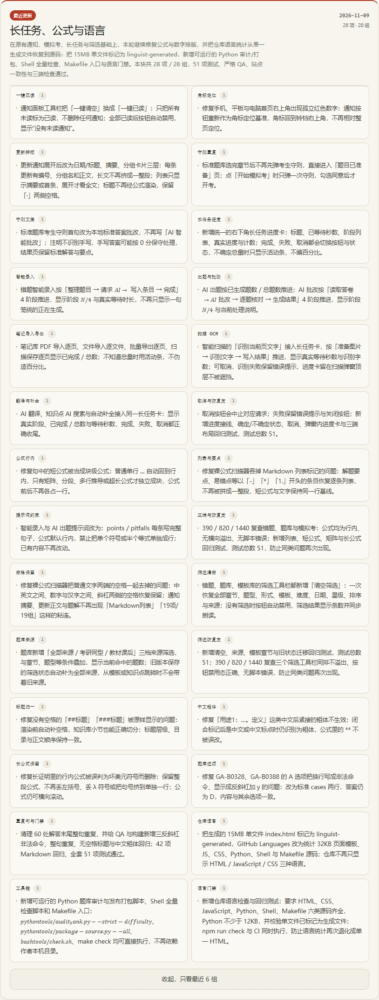

### 2026-11-08 · 公式、答题页与进度

**57 项 · 57 组**

在 11 月 8 日既有 54 项基础上，本轮补 3 项 AI 真实进度：智能录入、AI 出题、AI 批改都显示真实阶段与等待时长，出题按已生成题数推进；取消出题会中止请求，不再误入考生守则，批改可取消并回退标准答案。共 57 项 / 57 组，40 项测试、严格 QA 与站点一致性通过。

| 分组 | 本次更新 |
|---|---|
| **真实进度** | 错题智能录入、AI 出题、AI 批改统一接入真实进度条：出题按已生成题数与总题数推进，录入和批改按真实阶段与等待时长展示；没有确定总量时不显示假百分比，改为“第 N / M 步”。 |
| **取消与异常** | 取消 AI 出题会同时中止网络请求，迟到的结果不会再打开考生守则；取消 AI 批改会回退标准答案完成批改；AI 返回空对象或缺字段时不再因 null 属性崩溃。 |
| **进度门禁** | 新增进度组件、三条流程接线、生成取消与空批改结果的回归测试；发布源码不含调试钩子，测试总数 40，配合严格 QA 与站点一致性防止同类问题回潮。 |
| **首页工具栏** | 手机与平板首页的更新记录、语言、设置、通知四个入口从悬浮停靠改回页脚内联：按钮随内容换行，不再压住「期末复习」卡片与副标题；触控尺寸保持 36px，键盘焦点不变。 |
| **记录合并** | 把 2026-11-08 的三块更新记录合并为一块：通知已读、界面统一、审计修复共 57 项统一展示，保留「可访问性」等有效分组，删除同日重复的组与中间计数（28/30 项测试、203/287 个文件），只保留最终状态；历史日期不再被构建日改写。 |
| **日期门禁** | 删除构建时把首块日期强制改成构建日的逻辑；QA 新增同一天只允许一块、日期不得晚于今天、README/CHANGELOG 逐块计数校验，同日拆块或未来日期会直接阻止构建。 |
| **仓库徽章** | README 九个徽章换成九组彼此分离的颜色（橙 / 红 / 绿 / 蓝 / 琥珀 / 紫 / 品红 / 青 / 灰蓝），RELEASE 指向本版发布标签，VERSION 指向本版构建号，避免相邻徽章同色。 |
| **三端复核** | 390 / 820 / 1440 全路由复查首页、总览、错题、模板库、题库、规范、笔记库、期末复习与更新记录：首页工具栏不再遮挡内容，无横向溢出、无脚本错误，长公式仍按块横向滚动。 |
| **发布产物** | 重建 dist、dist-pages、四科错题本.html、静态站 zip、source.zip 与 SHA256SUMS；更新记录截图改用 20261108e 版本，README 与 Release 引用同步到同一构建。 |
| **文档同步** | README、CHANGELOG 与网页更新记录由同一份记录生成：最新块 57 项 / 57 组完整展开，旧块保留历史；Release 正文按对应版本摘要归档，仓库页计数、链接、截图与线上构建逐项核对。 |
| **测试基线** | 新增进度组件与取消逻辑回归测试，覆盖确定/不确定进度、三条流程接线、生成中止与空批改结果；测试总数 40，配合严格 QA 与站点一致性门禁防止同类问题回潮。 |
| **渲染白名单** | 修复 Markdown 渲染吞字与转义标签被拆成公式：保留粗体、斜体等行内标签与字面尖括号，未知标签解包保留文字，脚本、iframe 等危险标签整棵删除；新增回归测试。 |
| **表格渲染** | 表格行不再被当裸公式包成 $...$；题库、错题和笔记里的 Markdown 表格现在渲染为表格，单元格内公式仍按行内公式处理。 |
| **可访问性** | 科目页签补 role="tablist" 与 aria-label，品牌和首页入口的 aria-label 与可见文字一致；浅色 --faint 提到 #5f665c，暗色提到 #9aa091，对比度达标。 |
| **PDF 重试** | PDF 库加载失败后不再缓存失败 Promise；一次网络失败后可直接重试，不必刷新页面。 |
| **局域网口令** | node server.js --lan 未设 NOTEBOOK_TOKEN 时自动生成随机口令、打印口令并以失败关闭方式启动；无口令请求返回 401。 |
| **凭据隔离** | 本机服务默认不读取 ~/.dsh 中的凭据；只有显式设置 ALLOW_DSH_CREDENTIAL_REUSE=1 才复用，避免静默使用未授权配置。 |
| **打印横幅** | 打印时不再把 LOCAL FIRST 提示印在纸上；服务启动日志里的“三科错题本”改为“四科错题本”。 |
| **备份瘦身** | 备份默认只含用户错题、自建模板/题库、笔记和设置；内置 8825 题与 118 张模板不写入，导入不会回滚内置库；备份 schema 升到 v4。 |
| **构建自带技能** | 四个学科 skill 优先从仓库 skills/ 读取，SKILLS_ROOT 不可用也能构建；干净 clone 不再依赖作者家目录。 |
| **离线缓存** | 新增 service worker：首次成功打开后缓存页面，断网刷新可回最近一次成功页面；静态托管仍保持网络优先。 |
| **静态资源** | 补 robots.txt、sitemap.xml、manifest.webmanifest、favicon.svg、404.html 与 canonical/og/twitter 元数据；构建与发布同时复制这些文件。 |
| **未知路由** | 不存在的 #/ 链接不再静默停留：提示“链接指向的页面不存在”，并把地址纠正到首页或当前科目总览。 |
| **模板计数** | 首页与总览的模板数改为与模板库一致，包含用户新建模板；西经入口不再写死 16 张。 |
| **密钥提示** | 设置页 API Key 区域注明密钥只存本机 localStorage、导出备份会剔除、换设备需重新填写。 |
| **语言口径** | README 不再写“10 种语言内置”：内置简体中文，繁體中文部分内置，其余 8 种需配置 AI 生成；徽章改为“中文 + AI”。 |
| **QA 脚本** | 三个 QA 脚本改用动态端口和临时服务器，自动关闭欢迎弹窗并写入隔离种子；i18n 缓存键从源码读取，公式脚本不再依赖 Python。 |
| **页头节奏** | 统一首页、总览、错题、题库、模板库、规范、笔记库与期末复习的页头基线：标题、副标题和操作区在桌面底对齐，平板与手机改为纵向；副标题限宽，按钮换行时不再挤压标题，页头分隔线与正文起点对齐。 |
| **笔记宽度** | 笔记库在桌面收回到与其它页面一致的内容宽度，笔记本架与知识卡片不再横跨整屏；知识卡正文、标签和页脚重新分级字号，手机恢复单列。 |
| **期末分段** | 期末复习的「出模拟卷 / 进行模拟考」选中项增加左侧色条与浅色底，补上键盘焦点环；未选中项降低对比，手机上仍保持单列。 |
| **记录粒度** | 把 11-02 的 12 条合并长文拆成 26 个主题组：期末复习、模拟卷、模拟考、填空题、文档公式、满分校验、导出换行、删除保留、题库扩容、题库题型、题型清理、题库重制、评分排版、空白判分、结果难度、结果题干、客观答案、随机组卷、AI 批改、知识点搜索、公式与手写、科目与 skill、来源路径、源码开放、版式与三端、仓库一致性；11-08 同日三块合并为一块，不再保留同日重复记录。 |
| **历史清理** | 删除 11-01 表格后的重复说明段；统一 10-30 的标题顺序为「日期 · 主题」；11-08 同日记录合并为一块，历史日期只保留最终状态，不再由构建日改写。 |
| **仓库版面** | README 的 20261108c 更新记录截图移到对应版本，不再挂在 10-31 历史块末尾；配额说明改为「基础 8250 按每章 1–5★ 各 10 客观/填空/主观，教材 575 为补充、不占配额」；平板与桌面设置宽度分别写明 780 / 860。 |
| **记录门禁** | qa-site-consistency 读取更新记录，逐块比对 README 的日期、标题、项数、组数和表格行数，并检查最新截图引用位于对应更新块；任一不一致或截图文件缺失时构建失败。 |
| **三端复查** | 390 / 820 / 1440 复查首页、四科总览/错题/模板库/题库/规范、笔记库、期末复习与更新记录：无横向溢出、无脚本错误，长公式仍按块横向滚动。 |
| **通知已读** | 打开通知面板不再把所有通知标为已读；点开某条才标记该条，关闭面板不改变未读计数，角标只在真正阅读后减少。 |
| **可见文字** | 移除品牌与移动端品牌链接与可见文字不一致的 aria-label，改用 title 提示；首页仓库入口的浅色文字提到 10.5px，9–9.5px 的小字提到 10px。 |
| **题型归位** | 高代 150 道只带「应用情境：结合实际问题中的数据」前缀、没有真实情境的应用题改为计算题；100 道没有诊断信号的误差分析题改为计算题；同步标题分类并保持 8825 / 55 / 825 与每桶 10 题。 |
| **质量门禁** | QA、build 与 tests 新增：应用题不得保留伪情境前缀、高代误差分析题必须有误差/诊断信号、非教材题标题分类需与 category 一致；任一不满足构建或测试失败。 |
| **源码包** | source.zip 按当前工作树重建（排除 node_modules、dist、备份、debug 与生成产物），附 SHA256SUMS；解压后 npm ci、40 项测试、构建与严格 QA 全部通过。 |
| **记录边界** | 14.9MB 单文件首屏解析、内置题 verification/relatedEntries 为空、部分 templateId 空值属于结构/数据边界，本轮不伪装成已修复，继续在 README 边界说明中保留。 |
| **提示去重** | 同一条 toast 提示已经在屏幕上时不再重复叠加：存储损坏或恢复受阻时只保留一条提示，不再被连续写入触发的同文提示刷屏。 |
| **选项回填** | 从题库加入错题时保留 A–D 选项，并用空行分段；错题详情不再只剩题干，客观题选项里的公式也能正常渲染。 |
| **公式定界** | 中文行文里的裸算术（如 1/n < b-a）不再漏成普通文本；美元符号、Unicode 上下标、lim 与中文分式统一归一，题库、错题与模拟考全库 92837 个字段扫描 raw=0、公式 token=0。 |
| **MathML 排版** | MathML 从 display:inline 改为 display:inline math，子元素恢复 revert；分式、矩阵、上下标盒高不再被压成 15px 文字行高，公式与数字回到同一基线。 |
| **小问分段** | 证明与解答里的（1）（2）…自动另起段，长公式段落之间留出正常间距；手机上过宽公式保持块内横向滚动，不再把下一行顶开。 |
| **矩阵与要点** | 修复 3 道数分 vmatrix 缺行分隔导致的矩阵错位；清理 62 条要点里的奇数反引号与 7 条尾部悬空运算符，要点不再显示半截公式。 |
| **题库标题** | 西经 2400 条题库标题末尾重复的「· N★」统一剥离；星级只由徽标展示，标题不再被公式渲染器拆行。 |
| **数学措辞** | 数分 6 处「Archimedes 性」改为「阿基米德性」，并修正 4 处「由 阿基米德性」的断句。 |
| **三端操作** | 手机题库与错题操作按钮改为两列网格，复制 Markdown 不再落单；390 / 820 / 1440 复查题库、错题与模拟考的矩阵、分式和小问排版。 |
| **公式门禁** | 新增回归测试：中文裸算术渲染、日期与题库编号不被误包、错题保留选项、MathML 盒模型与移动端两列；测试总数 40，配合严格 QA 与站点一致性防止同类问题回潮。 |
| **常高吸附** | 答题页信息栏改为常高吸附外壳：滚动到试卷任何位置都能看到计时、已答数与交卷按钮，不再需要翻回试卷最上方；外壳占位高度固定，正文不会因信息栏收放而上下跳。 |
| **智能收缩** | 向下滚动超过一屏后信息栏收成窄栏；中途向上滚仍保持窄栏，只有回到页面顶端才恢复宽栏；页面在顶部时始终显示完整信息。 |
| **桌面交互** | 电脑端鼠标移入窄栏后展开、移出宽栏后恢复窄栏；单击窄栏或宽栏也能切换。点击交卷、暂时离开等按钮不会误触收放，页面滚动位置保持不变。 |
| **触屏交互** | 手机与平板轻触窄栏展开、再轻触恢复；在信息栏上向下拖动可直接展开查看，不必把试卷滚回顶部；触控与滚动位置同样保持稳定。 |
| **防闪烁** | 去掉信息栏高度、内边距与间距过渡，外壳固定高度；切换语言、长标题或长按钮时重新测量高度并允许合理换行，窄栏不横向溢出，也不会在宽窄之间来回跳动。 |
| **答题页门禁** | 新增答题页回归测试，覆盖吸附位置、常高外壳、顶部守卫、只在顶端恢复宽栏、桌面鼠标与点击、触屏轻触与下拉；390 / 820 / 1440 与十种语言实测无横向溢出、无脚本错误。 |

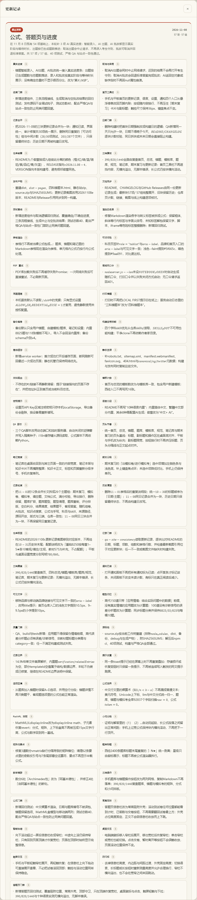

### 2026-11-07 · 全站排版与仓库校准

**9 项 · 9 组**

修复题库标题把章节号与星级当公式的问题，补齐题库、模板库与错题列表的标题层级；逐块核对 16 个日期的更新记录，删去 11-05 里引用 11-06 的未来句；同步仓库 README、CHANGELOG 与截图引用，并复查手机、平板、电脑三端布局与公式滚动。

| 分组 | 本次更新 |
|---|---|
| **题库标题** | 西方经济学题库标题里的“· 2★”不再被公式渲染器拆成三行；题库标题按纯文本输出，题库页主标题收为“题库”，副标题写明“考研同型 + 教材课后”。 |
| **标题层级** | 题库页、模板库与错题列表补上隐藏的二级标题，模板章节小节由 h5 改为 h4；视觉字号不变，读屏与大纲顺序更连贯。 |
| **记录日期** | 逐块核对 16 个日期的更新记录与构建日：删去 11-05 块里引用 11-06 的未来句，历史块只描述当天状态。 |
| **仓库文档** | README、CHANGELOG 与 GitHub README 的 11-07 区块同步为本轮 9 项/9 组；九个徽章颜色逐项复核为两两不同，截图引用统一到 20261107。 |
| **三端复查** | 390 / 820 / 1440 三档视口复查首页、四科总览/错题/模板库/题库/规范、笔记库、期末复习与更新记录：无横向溢出、无脚本错误，长公式仍按块横向滚动。 |
| **公式定界** | 错题正文里落单的美元符号不再把后半段 LaTeX 当普通文字显示；行内公式、独立公式与代码块里的 x 都按原样渲染。 |
| **矩阵与转置** | 修复矩阵证明中的转置符号、上下标和长公式排版：转置正确上标，长公式按块横向滚动，不再出现 LaTeX 源码与文字混排。 |
| **题库要点** | 补全 23 道题被截断的解题要点（高代 15 道、解几 8 道），把拆散的公式重新拼成完整表达式。 |
| **质量门禁** | Markdown 回归测试新增落单美元符号、LaTeX 源码与公式数量的断言；QA 与构建新增美元符号成对检查，公式被截断或定界符不配对时直接失败。 |

### 2026-11-06 · 日期、构建与节假日

**3 项 · 3 组**

构建号改为按本机实际日期生成，更新记录与仓库文档不再固定 2026-11-05；发布前统一核对构建号、三端页面与仓库文档。接入国务院办公厅 2027 年节假日安排，峰谷价按放假与调休上班日判断。

| 分组 | 本次更新 |
|---|---|
| **日期校准** | 构建号日期改为读取本机实际日期，不再硬编码 2026.11.05；本版构建号、更新记录与仓库文档统一为 2026-11-06。 |
| **发布校验** | 发布前统一核对构建号、更新记录、README 与线上三端页面，避免版本日期与文档日期脱节。 |
| **2027 节假日** | 接入《国务院办公厅关于2027年部分节假日安排的通知》：元旦 1/1–1/3、春节 2/5–2/13、清明 4/3–4/5、劳动 5/1–5/5、端午 6/9、中秋 9/15、国庆 10/1–10/7；1/31、2/14、5/8、9/26、10/9 调休上班，按工作日峰时计价。 |

### 2026-11-05 · 数据安全、公式与开源

**47 项 · 47 组**
