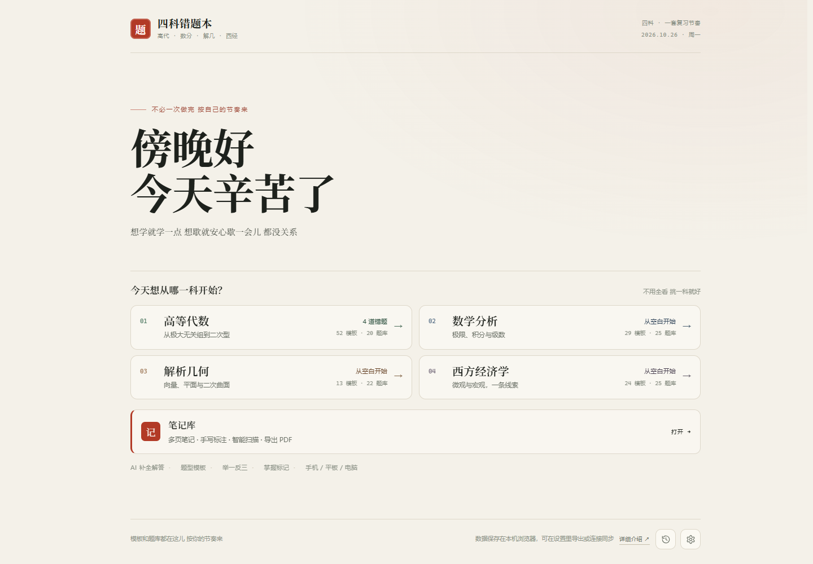
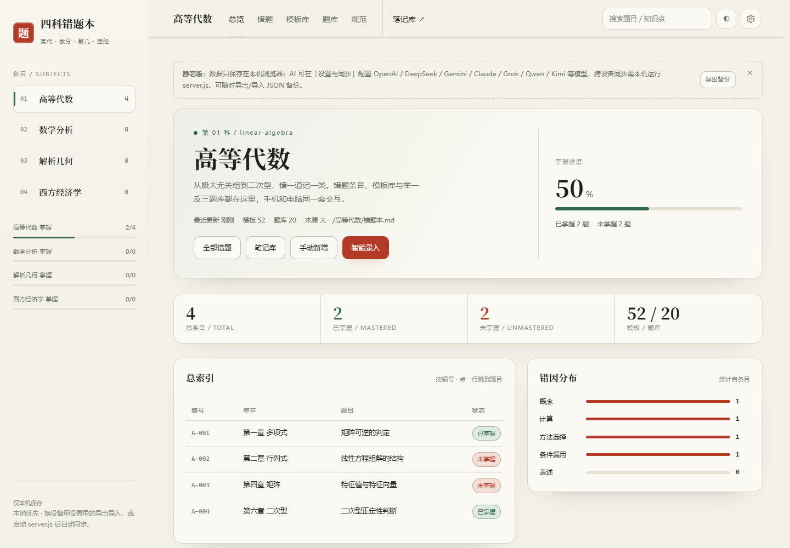
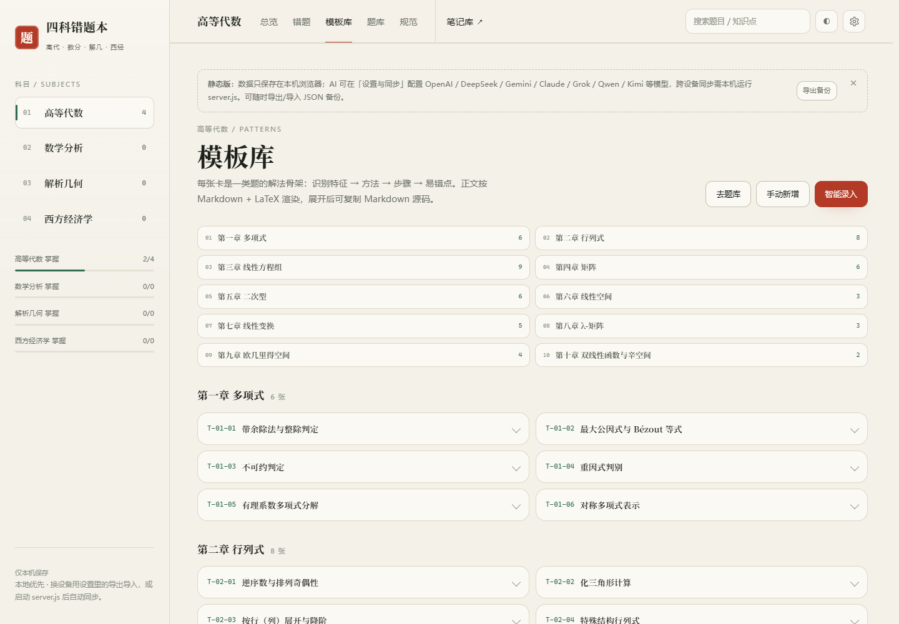
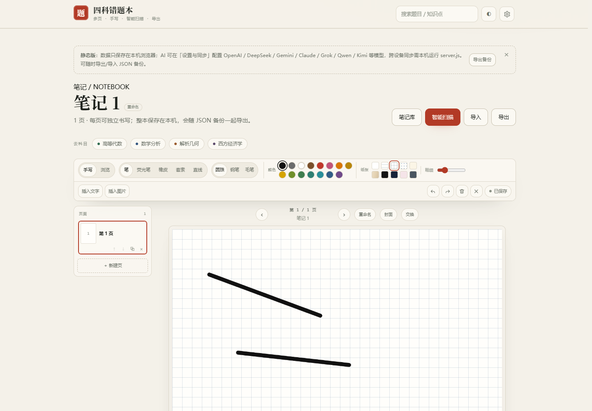
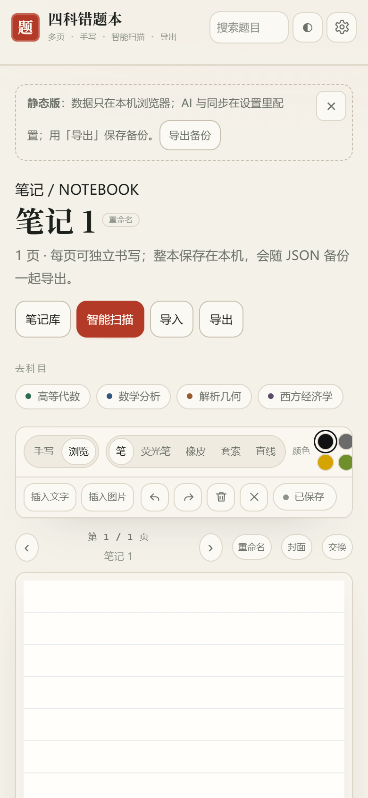
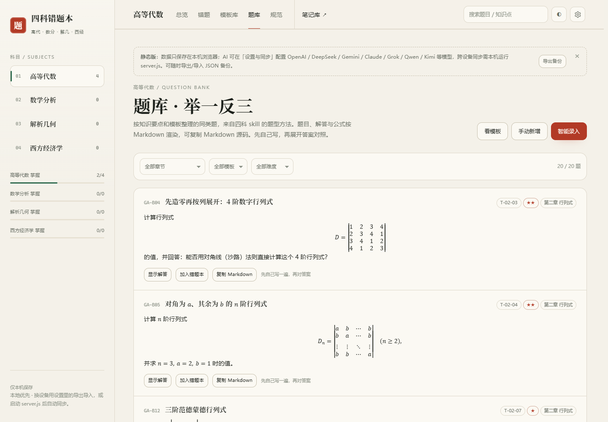
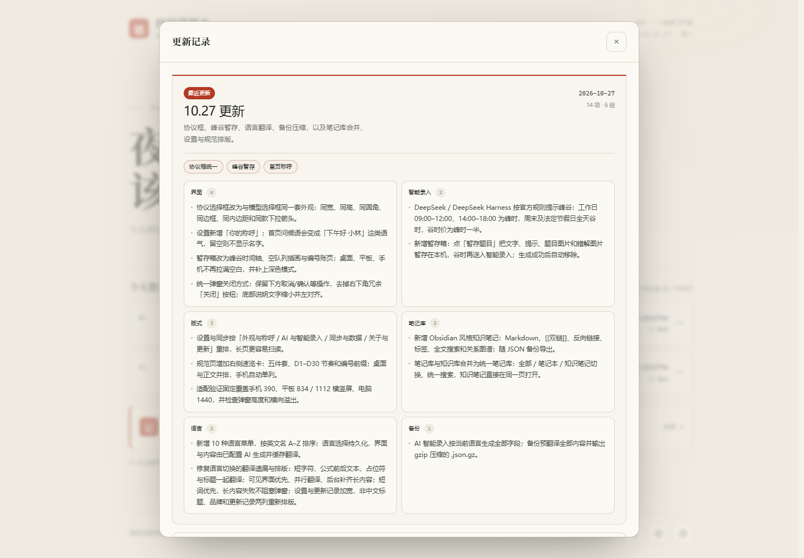

<h1>四科错题本</h1>

<b>高等代数 · 数学分析 · 解析几何 · 西方经济学</b> 
错题、模板、题库、AI 智能录入和手写笔记，放在一个单文件网页里。

118 张解答模板 · 92 道举一反三 · 2026-10-27 更新

<a href="https://github.com/lanzaihua/lanzaihua.github.io/releases/tag/v2026.10.27"><b>10.27 更新</b></a> · 协议框统一 · 峰谷暂存 · 首页称呼 · 设置分组

## 一眼看懂

| | |
|---|---|
| **适合** | 大学高代、数分、解几、西经的错题整理与考前复习 |
| **形态** | 单文件静态网页；打开即用，不需要注册 |
| **数据** | 默认只保存在当前浏览器；可导出 / 导入 JSON |
| **AI** | 可接 OpenAI、DeepSeek、Claude、Gemini、Grok、通义千问、Kimi |
| **规模** | 118 张解答模板、92 道举一反三题库 |
| **笔记** | 独立笔记库，多页、手写、智能扫描、插入文字图片、PNG / PDF 导出 |

**在线使用：** <https://lanzaihua.github.io/>

## 目录

[四科范围](#四科范围) · [核心功能](#核心功能) · [界面一览](#界面一览) · [使用方式](#使用方式) · [本地运行](#本地运行可选) · [适配验证](#适配验证) · [隐私与限制](#隐私与限制) · [更新记录](#更新记录)

## 四科范围

| 科目 | 主要内容 | 模板 | 题库 |
|---|---|---:|---:|
| 高等代数 | 行列式、矩阵、线性方程组、向量空间、线性变换、特征值、二次型、欧氏空间 | 52 | 20 |
| 数学分析 | 极限、连续、导数、积分、级数、多元微积分、曲线曲面积分 | 29 | 25 |
| 解析几何 | 向量与坐标、平面与空间直线、柱面锥面旋转曲面、二次曲线与二次曲面 | 13 | 22 |
| 西方经济学 | 供求、弹性、消费者、生产者、成本、市场结构、市场失灵、GDP、IS-LM、AD-AS、失业、通胀、增长 | 24 | 25 |
| **合计** |  | **118** | **92** |

- 四科分开建册，每科有自己的编号、章节、模板和题库。
- 模板覆盖「识别特征 / 首选方法 / 步骤骨架 / 易错点」四段。
- 题库是自拟变式，不是教材原题，按章节和模板标注来源。
- **初始错题本为空**：打开就能录入第一道题，模板库与题库已经准备好。

## 核心功能

### 错题记录

- 册内唯一编号：高代 <code>A-001</code>、数分 <code>M-001</code>、解几 <code>G-001</code>、西经 <code>E-001</code>。
- 记录原题、考试标准解答、详细解析、答案、模板、章节、知识要点、难度、错因标签。
- 可标记 **已掌握 / 未掌握**，首页与科目页同步统计。
- 支持关键词、章节、模板、难度、状态筛选，支持编辑、删除、展开阅读。
- 空状态只保留「手动新增 / 智能录入」两个入口，减少重复操作。

### 模板库与题库

- 118 张模板按科目和章节组织，顶部章节目录可直接跳转。
- 桌面端双列卡片，展开后自动占满整行，公式仍是完整宽度。
- 92 道题库题可展开查看标准解答、详细解析、答案和解题要点。
- 支持「先自己做，再对照答案」；题目和解答分开显示。
- 模板、题库、错题条目都能复制 Markdown 源码。

### 笔记

独立于四科的全局笔记库，从首页进入；科目页顶栏也能随时跳转。

- **手写**：笔、荧光笔、橡皮、15 种笔色，黑色为默认；圆珠笔 / 钢笔 / 毛笔三档笔锋。
- **纸张**：纯白、横线、方格、点阵、米黄、牛皮、黑色、深蓝、浅粉、灰蓝 10 种。
- **插入**：文字框、图片；插入后自动选中，可拖动或缩放，也能在图片上继续书写。
- **多页**：一本笔记多页，底部只显示当前笔记的页面。
- **笔记库**：封面网格、名称搜索、单本删除、批量删除，删除前均需确认。
- **智能扫描**：拍照或选择图片后进入智能扫描工作台，自动裁边、原图 / 自动 / 增强 / 灰度 / 黑白滤镜、旋转、裁边调节、连续扫描多页，保存后可直接导出 PDF。

- **导入**：图片直接导入，PDF 逐页转成可标注页面。
- **保存**：自动保存，也可点「保存」或 <kbd>Ctrl</kbd> / <kbd>⌘</kbd> + <kbd>S</kbd>；显示「保存 / 已保存」状态。
- **重命名**：编辑页标题可直接点击改名，页栏也保留重命名按钮。
- **导出**：PNG / PDF；可选当前 / 全部笔记、单页 / 多页 / 合并多页。
- **页面侧栏**：桌面端显示页面缩略图，可复制、上移、下移、删除页面；手机端保留底部页签。
- **动态页码**：页面侧栏、底部页签、页栏和导出页选择会按当前顺序自动编号；插入智能扫描页也会插到当前页之后并重排页码。

- **封面**：笔记库支持米白、朱砂、松绿、靛蓝、玄黑、牛皮 6 种封面。
- **直线与套索复制**：新增直线工具；套索圈选后可整段复制或删除。
- **互跳**：笔记页有四科快捷入口，科目页有笔记库入口。

### AI 智能录入

配置模型后，可以只输入题目文字，也可以拍照 / 上传题目图片，让 AI 一次生成：

- 考试标准解答、详细解析、答案。
- 同类型解答模板：识别特征 / 首选方法 / 步骤骨架 / 易错点。
- 1–2 道变式题，用于举一反三。
- 章节、知识要点、难度、错因标签。

**可选错解诊断**：勾选「添加我的错解」，写一段错解文字或上传最多 3 张错解图片，AI 会先给出四段诊断：错在哪一步、真正卡住的点、应该怎么改、下次怎么防，再给标准解答。不勾选时按原来的流程生成。

支持的模型服务：

- OpenAI 及任意 OpenAI 兼容接口
- DeepSeek / DeepSeek Harness
- Anthropic Claude
- Google Gemini
- xAI Grok
- 通义千问
- Moonshot Kimi

模型字段可搜索、可手动输入；模型不可用时会从列表移除并切换默认模型。

### 录入后自动补全

- 新错题进入自动队列，默认约 12 秒后开始，在 10 分钟窗口内补齐解答。
- 状态：AI 待补全 / 补全中 / 待配置 AI / 已补全 / 失败。
- 可手动「立即补全」「重试」「跳过」。
- 页面关闭后队列保留，下次打开继续；纯静态页无法在关页后执行，需要常驻 Node 后端。

### 数据、备份与同步

- 数据默认保存在浏览器 <code>localStorage</code>。
- 可在「设置与同步」导出 / 导入 JSON；换设备或清缓存前先备份。
- 导入时可选择「合并」或「覆盖」；编号冲突会先比较内容，必要时重新编号。
- 纯静态 GitHub Pages 没有跨设备同步。
- 本机运行 <code>node server.js</code> 后，可通过 <code>/api/state</code> 跨设备同步，也能代理 AI 请求。

## 界面一览

四科统一总览 · 模板与题库 · 笔记编辑 · 手机端 · 更新记录

<table>
<tr>
<td width="50%"> <b>四科总览</b> · 掌握进度、错因分布、总索引</td>
<td width="50%"> <b>模板库</b> · 章节目录与双列卡片</td>
</tr>
<tr>
<td width="50%"> <b>笔记编辑</b> · 双行工具栏与紧凑色板</td>
<td width="50%"> <b>手机笔记</b> · 单行页头与横向工具栏</td>
</tr>
<tr>
<td width="50%"> <b>题库</b> · 先做题，再展开答案</td>
<td width="50%"> <b>更新记录</b> · 版本摘要与分类卡片</td>
</tr>
</table>

## 使用方式

1. 打开 <https://lanzaihua.github.io/>。
2. 选择科目，点「手动新增」逐题录入，或点「智能录入」让 AI 生成。
3. 先自己写一遍，再对照标准解答和详细解析。
4. 用「已掌握 / 未掌握」记录状态，用题库做变式自测。
5. 定期在「设置与同步」导出备份。

## 本地运行（可选）

需要跨设备同步、服务端 AI 代理或局域网访问时：

    node server.js

默认地址：<http://127.0.0.1:4173>。手机访问：

    node server.js --lan

服务端 AI 配置示例：

    AI_PROTOCOL=openai \
    AI_BASE_URL=https://api.openai.com/v1 \
    AI_MODEL=gpt-6.1-sol-pro \
    AI_API_KEY=你的Key \
    node server.js

未配置 AI 时，错题、模板、题库、笔记等普通功能不受影响。

## 屏幕适配

- 手机 320–430px：顶栏分成品牌、科目、标签三行；320px 下科目按钮 2×2，搜索保留，主题移入设置。
- 平板 / Fold 内屏 600–900px：隐藏侧栏，内容单列，统计卡两列。
- 桌面 1440–1920px：正文最大宽度 1280px，避免行太长。
- 长表格、长公式在自身容器内横向滑动，不会把整页撑出横向滚动。
- 折叠屏、iPad mini、HUAWEI Mate XT、OPPO Pad Mini 等设备已验证无横向溢出。

## 适配验证

每次改版同时检查手机、平板和电脑，不只验证桌面：

| 设备 | 视口 |
|---|---|
| 手机 | 390 × 844 |
| 平板竖屏 | 834 × 1112 |
| 平板横屏 | 1112 × 834 |
| 电脑 | 1440 × 1000 |

~~~bash
npm i -D playwright-core
node tools/qa-responsive.js
~~~

检查范围：首页、四科总览、错题、模板库、题库、规范、笔记、设置、更新记录；同时检查横向溢出、设置分组、更新记录分栏、规范速览和弹窗高度。

## 隐私与限制

- 不需要注册，没有账号系统，也没有云端用户数据。
- 错题默认只存在当前浏览器；换浏览器、换设备、清缓存不会自动迁移。
- AI Key 只存在浏览器；使用本机 server 时，页面携带的配置会发到你自己的服务端。
- 纯静态页的 AI 直连依赖接口 CORS；被浏览器拦截时请改用本机 server。
- 四科技能材料会压缩内联进静态页；公开页面在技术上可被解出，需要严格保护请私有部署。
- 模型输出可能出错，请对照题干、课本和定理依据核对。
- 页面是学习辅助工具，不保证 AI 解答正确，也不替代教材、老师和考试要求。

## 技术说明

- 单文件静态应用，部署在 GitHub Pages。
- Markdown 由 marked 解析，数学公式由 Temml 渲染。
- 无前端框架运行时依赖，打开 HTML 即可使用。
- 可选 Node 后端负责静态服务、状态同步和 AI 代理。
- 数据格式为浏览器 localStorage 中的 JSON，可通过页面导出 / 导入迁移。

## 更新记录

### 2026-10-27 · 10.27 更新

| 类别 | 内容 |
|---|---|
| **协议** | 协议选择框与模型选择框同宽、同高、同圆角、同边框、同内边距和同款下拉箭头 |
| **智能录入** | 按官方规则提示峰谷：工作日 09:00–12:00、14:00–18:00 为峰时，周末及节假日谷时；暂存箱保存题目、提示和图片 |
| **首页** | 设置可填「你的称呼」，问候语按有无称呼显示，留空时不带名字 |
| **设置** | 按「外观与称呼 / AI 与智能录入 / 同步与数据 / 关于与更新」四组重排，长页更易扫读 |
| **规范** | 新增右侧速览卡：五件套、D1–D30 节奏、编号前缀；桌面并排，手机单列 |
| **适配** | 验证覆盖手机、平板横竖屏、电脑；平板更新记录弹窗不再拉满全屏 |

<b>2026-10-26 · 10.26 更新</b> · 25 项

| 方向 | 这次改了什么 |
|---|---|
| **页面流** | 新建页跟随当前页并继承纸张；编辑页头移除冗余「新建页」，保留批量删页 |
| **导出** | 导出笔记弹窗重排为范围、页面、格式三个分区，页面选择改为网格 |
| **手写** | 笔默认 12 / 最大 56，橡皮默认 48 / 最大 140；15 种笔色、10 种纸张 |
| **手机** | 撤销 / 重做保持工具栏位置；切换工具不再跳动；导出按钮首屏可见 |
| **扫描** | 手机智能扫描改为预览、滤镜卡片、调整卡片、扫描队列和固定底栏；自动裁边检测纸张四角；配置 AI 后支持印刷体 / 手写体 OCR |
| **版式** | 笔记工具栏改为两行分组；颜色移除墨色，按中性到冷暖排序 15 色 |
| **回笔** | 橡皮状态下点颜色，自动切回上次使用的笔 / 荧光笔 / 直线 |
| **空状态** | 笔记库空状态改为双栏开始页，空库不再显示导出与批量删除 |
| **题库 / 模板** | 新增错题自动入题库，变式同步入库，答题模板自动补入模板库；题库五段内容齐备 |
| **复习** | 错题支持按章节正序 / 倒序，并记住排序选择 |
| **备份 / 导入** | 备份包含模板与题库；相同内容跳过，编号冲突按章节重排 |
| **设置** | 恢复初始数据清空错题、笔记、AI 配置、同步口令和所有设置，只保留模板与题库 |
| **规范** | 四科规范页统一字段、编号、书写格式、D1–D30 复习节奏和维护约定 |
| **文档** | 网页更新记录改为版本摘要 + 分类卡片；README 更新记录改为表格 + 折叠历史 |

#### 本版细节

- 新建页和智能扫描页都跟随当前阅读位置，复制页仍放在原页之后。
- 批量删页支持多选、全选、删除选中和取消；删除最后一页会移除整本笔记。
- 新增白色笔与黑色纸，深色纸的横线、方格和点阵自动使用浅色线条。
- 笔色移除墨色，保留黑色为默认；按中性、棕、暖、绿、冷、紫排序 15 色，色点间距统一。
- 笔记工具栏改为两行分组：模式、工具、笔锋、颜色、纸张、粗细一行；插入和撤销保存一行，颜色与纸张改为紧凑双行色板。
- 橡皮状态下点颜色会自动切回上次使用的笔（笔 / 荧光笔 / 直线），并保留原来的笔锋。
- 导出弹窗中的范围、页面、格式分区更清楚，PNG / PDF 与 PDF 合订方式更容易核对。
- 手机端页头五项操作压缩为一行，导入按钮缩短为「导入」，导出不再藏在横向滚动里。
- 新建页继承当前页纸张；页头移除冗余「新建页」，页面侧栏和底部页签入口保留。
- 手机智能扫描改为预览、滤镜卡片、调整卡片、本次扫描和固定底栏，控件不再与预览说明重叠。
- 自动裁边改为纸张四角检测：裁掉桌面背景，倾斜照片保留纸张轮廓，识别失败时保留原图并提示。
- 智能扫描接入 OCR：配置带视觉能力的 AI 后，可识别印刷体与手写体，结果可编辑、复制或下载 TXT。
- 新增错题自动进入题库，举一反三同步入库；答题模板自动补入模板库。
- 题库展开统一显示考试标准解答、详细解析、答案、解题要点、易错点五段。
- 错题页支持章节正序 / 倒序，排序写入本机设置，刷新后保持。
- JSON 备份包含模板库和题库；导入时完全相同的内容跳过，编号冲突按章节顺序重新编号。
- 笔记库空状态改为「从第一本开始」双栏引导；空库不再显示导出与批量删除。
- 四科总览总索引精简为编号、章节、题目、状态四列，桌面端不再横向滑动。
- 四科规范页统一条目规范与复习法，四个科目展示同一套字段、编号、格式和 D1–D30 节奏。
- 更新记录改为版本摘要、重点标签和分类卡片；更早版本默认折叠，仓库 README 同步为表格加折叠历史。

2026-10-25 · 笔记与版式更新

#### 笔记编辑

- 页面侧栏、封面主题、复制 / 上下移动页面、直线工具和套索复制。
- 页码动态重排，支持任意两页交换。
- 自定义封面支持导入图片、裁切填满 / 完整显示、缩放和拖动取景。
- 智能扫描改为多页扫描工作台，支持自动裁边、滤镜、旋转、连续扫描和保存后导出 PDF。

#### 界面与数据

- 模板库增加章节目录与双列卡片；错题页筛选与新建分区；规范页收窄行宽。
- 四科总览统一为总索引、错因分布、按章索引、最近动过、复习法。
- 西经路由迁移到 <code>#/xijing</code>，内部存储键同步迁移；旧链接与旧备份自动迁移。
- 手机笔记编辑器压缩为双行工具栏和单行页头操作，画布更早进入首屏。

2026-10-24 / 2026-10-23 · 历史更新

- **2026-10-24**：6 种纸张、8 种笔色、插入文字 / 图片、更粗笔锋、橡皮范围圈；编号统一为 A / M / G / E；补充手机、平板和折叠屏适配。
- **2026-10-23**：四科错题本上线；118 张模板、92 道题库；掌握状态、搜索筛选、导出导入；本地 localStorage 与本机 server 同步。

完整记录见 [CHANGELOG.md](CHANGELOG.md)。

## 反馈

如果发现排版、题目、模板或 AI 生成结果有问题，欢迎在仓库提 Issue，或直接通过页面里的编辑功能修正自己的副本。

---

把做过的题留住，把下一次做对。

