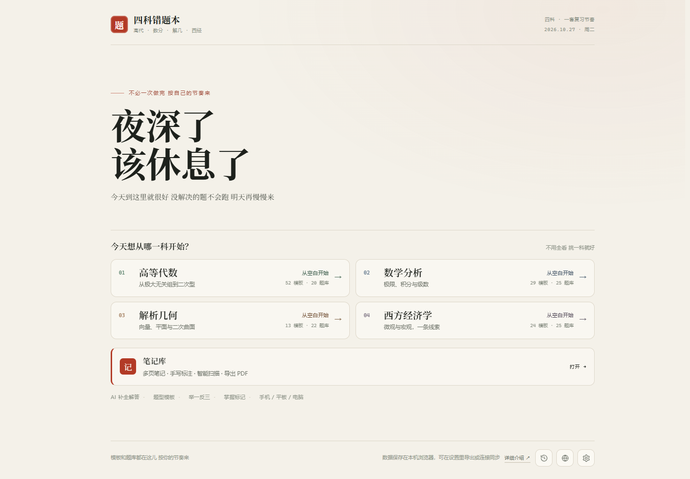
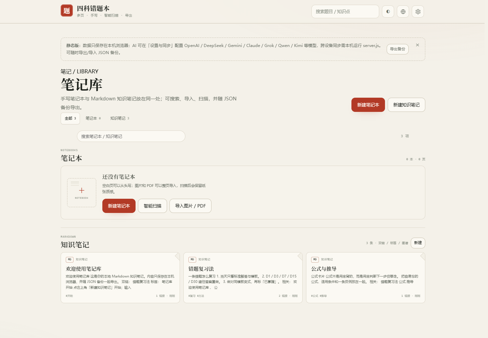

<h1>四科错题本</h1>

<b>高等代数 · 数学分析 · 解析几何 · 西方经济学</b> 
错题、模板、题库、AI 智能录入、手写笔记和 Markdown 知识笔记，放在一个单文件网页里。

<a href="https://lanzaihua.github.io/"><b>开始使用</b></a> · <a href="#功能">功能</a> · <a href="#界面">界面</a> · <a href="#更新记录">更新记录</a> · <a href="#隐私与限制">隐私与限制</a>

> 一个单文件学习工作台。错题、解答模板、举一反三题库、AI 智能录入和笔记共享同一套编号与复习节奏；数据默认只留在本机。

## 快速开始

1. 打开 **https://lanzaihua.github.io/**。
2. 选择一科，手动新增错题，或者把题目交给 AI 智能录入。
3. 先自己做一遍，再对照标准解答、详细解析和模板；用题库做同类型变式。

| 适合 | 现在包含 | 数据方式 |
|---|---|---|
| 大学高代、数分、解几、西经的错题整理与考前复习 | **118** 张解答模板 · **92** 道举一反三 · 统一笔记库 | 默认 localStorage；可导出 / 导入 JSON 备份 |

## 四个科目

| 科目 | 主要内容 | 模板 | 题库 |
|---|---|---:|---:|
| 高等代数 | 行列式、矩阵、线性方程组、向量空间、线性变换、特征值、二次型、欧氏空间 | 52 | 20 |
| 数学分析 | 极限、连续、导数、积分、级数、多元微积分、曲线曲面积分 | 29 | 25 |
| 解析几何 | 向量与坐标、平面与空间直线、柱面锥面旋转曲面、二次曲线与二次曲面 | 13 | 22 |
| 西方经济学 | 供求、弹性、消费者、生产者、成本、市场结构、市场失灵、GDP、IS-LM、AD-AS、失业、通胀、增长 | 24 | 25 |
| **合计** | | **118** | **92** |

四科分开建册。每科有自己的编号、章节、模板和题库，互不混淆。

## 功能

### 错题记录

- 册内唯一编号：高代 <code>A-001</code>、数分 <code>M-001</code>、解几 <code>G-001</code>、西经 <code>E-001</code>。
- 记录原题、考试标准解答、详细解析、答案、模板、章节、知识要点、难度和错因。
- 已掌握 / 未掌握状态会同步到首页和科目页统计。
- 支持关键词、章节、模板、难度、状态筛选，以及编辑、删除和展开阅读。

### 模板与题库

- 118 张模板按科目和章节组织，顶部章节目录可直接跳转。
- 模板固定四段：识别特征 / 首选方法 / 步骤骨架 / 易错点。
- 92 道题库题可以展开查看标准解答、详细解析、答案、解题要点和易错点。
- 模板、题库、错题条目都支持复制 Markdown 源码。

### 统一笔记库

- **手写笔记本**：笔、荧光笔、橡皮、直线、套索；10 种纸张；多页；插入文字和图片。
- **知识笔记**：Markdown、<code>[[双链]]</code>、反向链接、标签、全文搜索和关系图谱。
- **统一入口**：全部 / 笔记本 / 知识笔记切换，共用同一个搜索框。
- **智能扫描**：自动裁边、滤镜、旋转、连续扫描多页、OCR，保存后可导出 PDF。
- **导入导出**：图片、PDF 转页面；PNG / PDF 导出；数据随 JSON 备份。

### AI 智能录入

配置模型后，可以输入文字或上传题目图片，让 AI 一次生成考试标准解答、详细解析、答案、模板四段和 1–2 道变式。

- 支持 OpenAI 兼容接口、DeepSeek / DeepSeek Harness、Claude、Gemini、Grok、通义千问、Moonshot Kimi。
- 可选错解诊断：先指出错在哪一步、真正卡点、怎么改、下次怎么防，再给标准解答。
- DeepSeek 峰谷提示按官方规则：工作日 09:00–12:00、14:00–18:00 为峰时，周末和法定节假日全天谷时。
- 峰时可先暂存题目和图片，谷时再送入生成；暂存只存在本机。
- 新错题可自动进入补全队列；页面关闭后队列保留，下次打开继续。

### 数据、备份与语言

- 数据默认只在本机浏览器；换设备或清缓存前请先导出备份。
- JSON 备份包含错题、模板、题库、笔记和知识笔记；支持合并或覆盖导入。
- 当前语言备份会预翻译内容并输出 gzip 压缩的 <code>.json.gz</code>，文件更小。
- 10 种语言：简体中文、繁體中文、English、Français、Deutsch、日本語、한국어、Português、Русский、Español。
- 语言选择持久化；界面、题库、规范、笔记和弹窗使用同一套翻译缓存。

## 界面

统一首页 · 笔记库 · 模板库 · 更新记录

<table>
<tr>
<td width="50%"> <b>首页</b> · 按自己的节奏开始</td>
<td width="50%"> <b>笔记库</b> · 手写笔记本与 Markdown 知识笔记</td>
</tr>
<tr>
<td width="50%"> <b>模板库</b> · 章节索引与双列卡片</td>
<td width="50%"> <b>更新记录</b> · 六组分类与两列阅读</td>
</tr>
</table>

## 屏幕适配

| 设备 | 视口 | 处理 |
|---|---|---|
| 手机 | 390 × 844 | 单列内容，操作按钮可横向滚动，弹窗内部滚动 |
| 平板竖屏 | 834 × 1112 | 隐藏侧栏，设置 780 宽，更新记录两列 |
| 平板横屏 | 1112 × 834 | 设置 860 宽，更新记录两列 |
| 电脑 | 1440 × 1000 | 正文限宽，设置 860，更新记录 860 / 两列 |

长表格、长公式在自身容器内横向滑动，不会把整页撑出横向滚动。

<b>适配验证命令</b>

    npm i -D playwright-core
    node tools/qa-responsive.js

检查范围：首页、总览、错题、模板库、题库、规范、笔记、设置、更新记录，以及横向溢出、弹窗高度和分栏。

## 更新记录

### 2026-10-27 · 10.27 更新

**14 项 · 6 组**

协议框、峰谷暂存、语言翻译、备份压缩，以及笔记库合并、设置与规范排版。

| 组 | 这版做了什么 |
|---|---|
| **界面** | 协议框统一；设置增加称呼；暂存箱改为峰谷时间轴、空队列插画与编号账页；弹窗去掉冗余「关闭」，底部说明缩小并左对齐。 |
| **智能录入** | DeepSeek 按官方峰谷规则提示；新增暂存箱，峰时先放题目和图片，谷时再生成。 |
| **版式** | 设置四组重排；空状态加入纸张标记；规范页增加速览卡；适配验证固定覆盖手机、平板横竖屏和电脑。 |
| **笔记库** | 新增 Obsidian 风格知识笔记；笔记库与知识库合并，统一搜索、类型切换和 Markdown 卡片。 |
| **语言** | 10 种语言菜单，按英文名 A–Z 排序；界面与内容 AI 翻译并缓存；修复串语言、弹窗不刷新、短字符与公式夹缝漏翻；可见界面优先、并行翻译、后台补齐长内容。 |
| **备份** | AI 生成内容按当前语言写入；备份预翻译并输出 gzip 压缩的 <code>.json.gz</code>。 |

<b>2026-10-26 · 10.26 更新</b> · 25 项

- 笔记导出重排为范围 / 页面 / 格式；手机扫描改为预览、滤镜和固定底栏。
- 笔记工具栏改为两行分组；新增黑色纸、白色笔，笔色整理为 15 种。
- 错题自动进入题库，变式同步入库，答题模板自动补入模板库。
- JSON 备份包含模板和题库；编号冲突按章节重排；设置支持恢复初始数据。
- 更新记录改为版本摘要、重点标签和分类卡片；更早版本默认折叠。

<b>2026-10-25 及更早</b>

- **10.25**：笔记库、多页笔记、智能扫描、封面、直线和套索复制、动态页码。
- **10.24**：6 种纸张、8 种笔色、插入文字 / 图片、更粗笔锋、手机和平板适配。
- **10.23**：四科错题本上线；118 张模板、92 道题库；掌握状态、搜索筛选、导出导入。

完整记录见 [CHANGELOG.md](CHANGELOG.md)。

## 隐私与限制

- 不需要注册，没有账号系统，也没有云端用户数据。
- 错题默认只存在当前浏览器；换浏览器、换设备或清缓存不会自动迁移。
- AI Key 只存在浏览器；使用本机 server 时，页面携带的配置会发到你自己的服务端。
- 纯静态页的 AI 直连依赖接口 CORS；被浏览器拦截时请改用本机 server。
- 模型输出可能出错，请对照题干、课本和定理依据核对。
- 页面是学习辅助工具，不保证 AI 解答正确，也不替代教材、老师和考试要求。

## 本地运行

需要跨设备同步、服务端 AI 代理或局域网访问时：

    node server.js

默认地址：<http://127.0.0.1:4173>。手机访问：

    node server.js --lan

未配置 AI 时，错题、模板、题库、笔记等普通功能不受影响。

## 技术说明

- 单文件静态应用，部署在 GitHub Pages。
- Markdown 由 marked 解析，数学公式由 Temml 渲染。
- 无前端框架运行时依赖，打开 HTML 即可使用。
- 可选 Node 后端负责静态服务、状态同步和 AI 代理。
- 数据格式为浏览器 localStorage 中的 JSON，可通过页面导出 / 导入迁移。

## 反馈

如果发现排版、题目、模板或 AI 生成结果有问题，欢迎在仓库提 Issue，或直接在页面里修正自己的副本。

---

把做过的题留住，把下一次做对。

