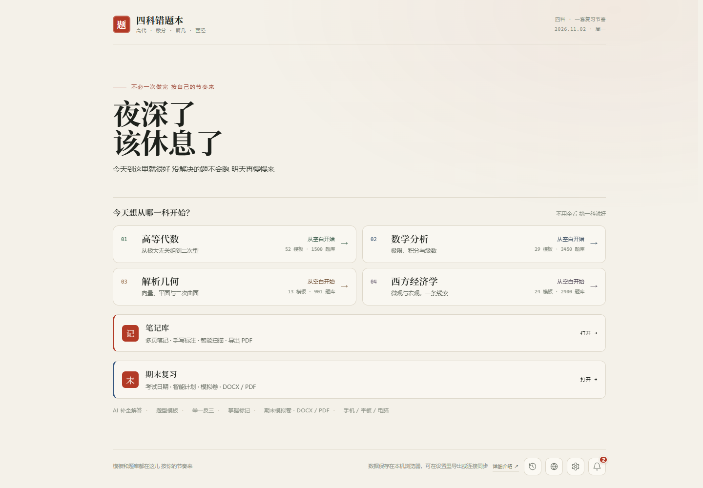
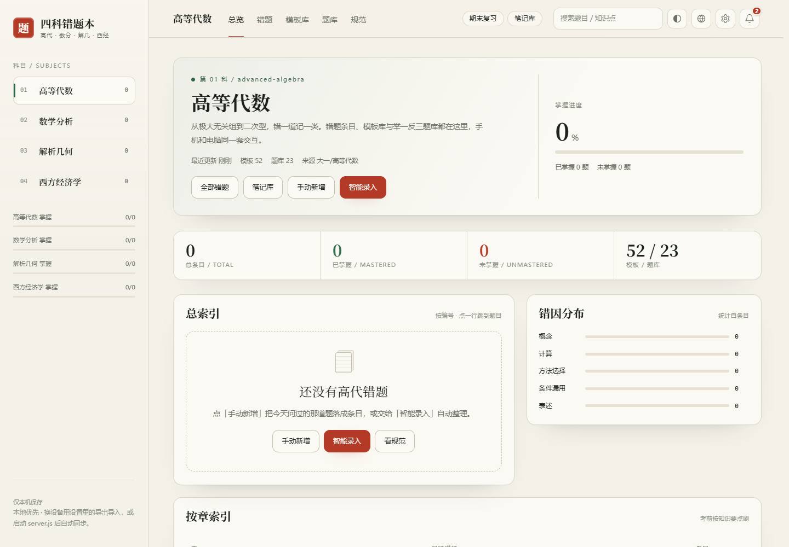
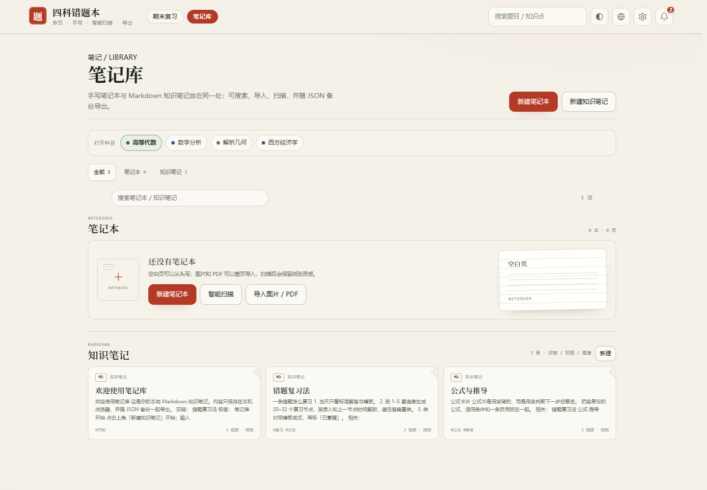
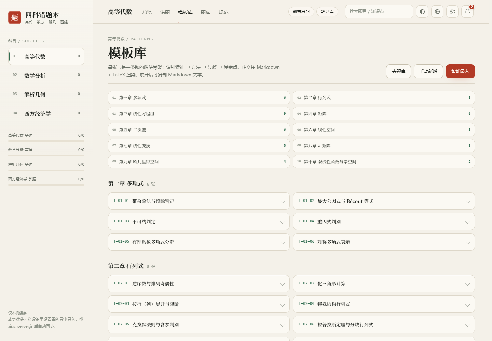
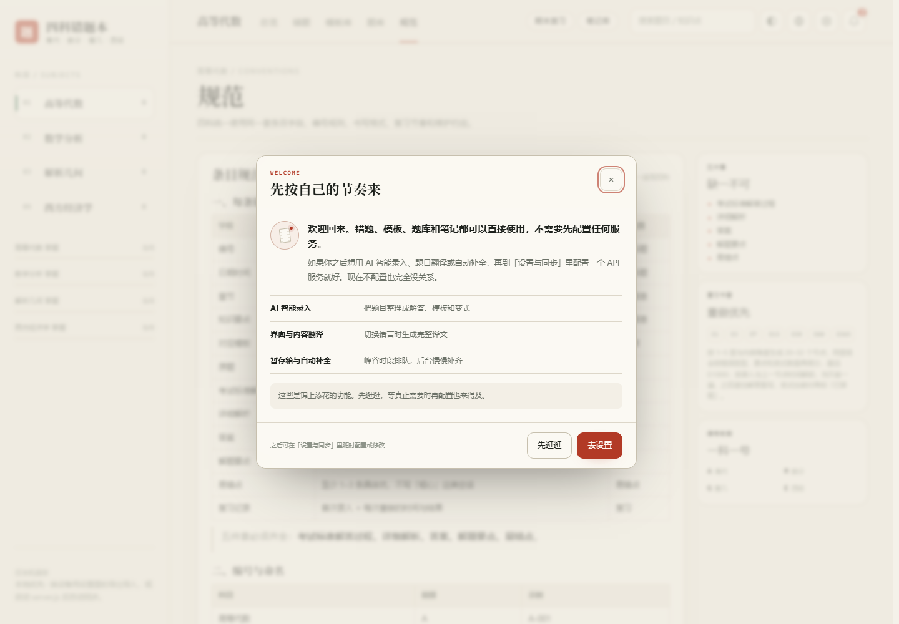
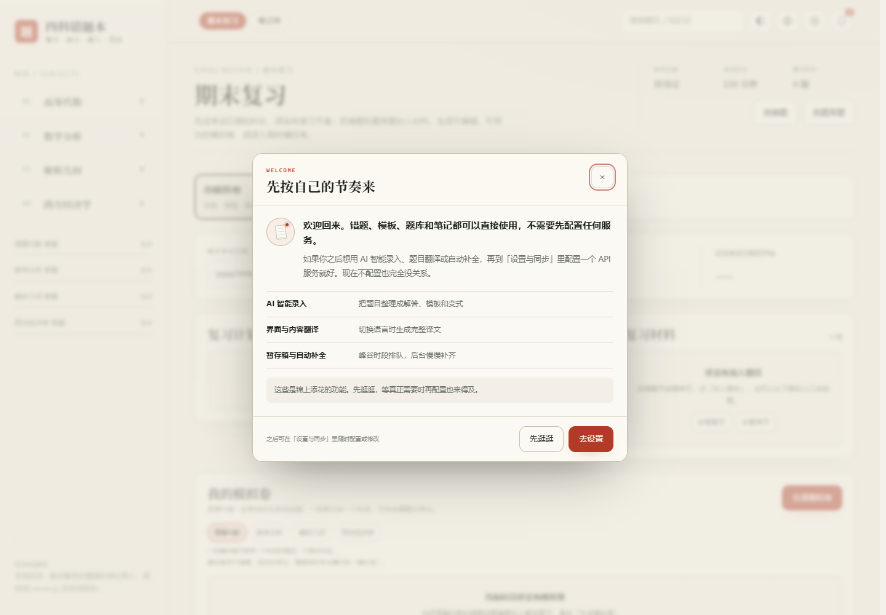
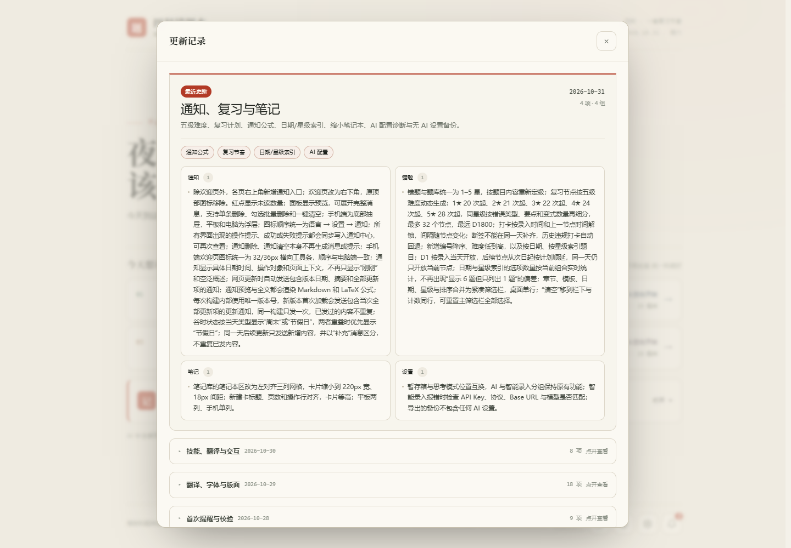

<h1>四科错题本</h1>

<b>高等代数 · 数学分析 · 解析几何 · 西方经济学</b> 
错题、模板、题库、AI 智能录入、期末复习与单科模拟考、手写笔记和 Markdown 知识笔记，放在一个单文件网页里。

<b>118</b> 解答模板 · <b>99</b> 道题库 · <b>4</b> 科 · <b>10</b> 种语言 · <b>0</b> 注册

<a href="https://lanzaihua.github.io/"><b>开始使用</b></a> · <a href="#功能">功能</a> · <a href="#界面">界面</a> · <a href="#更新记录">更新记录</a> · <a href="#隐私与限制">隐私与限制</a>

> 一个单文件学习工作台。错题、解答模板、举一反三题库、AI 智能录入和笔记共享同一套编号与复习节奏；数据默认只留在本机。

## 快速开始

1. 打开 <https://lanzaihua.github.io/>。
2. 选择一科，手动新增错题，或者把题目交给 AI 智能录入。
3. 先自己做一遍，再对照标准解答、详细解析和模板；用题库做同类型变式。

| 适合 | 现在包含 | 数据方式 |
|---|---|---|
| 大学高代、数分、解几、西经的错题整理与考前复习 | **118** 张解答模板 · **99** 道举一反三 · 统一笔记库 | 默认 localStorage；可导出 / 导入 JSON 备份 |

## 四个科目

| 科目 | 主要内容 | 模板 | 题库 |
|---|---|---:|---:|
| 高等代数 | 行列式、矩阵、线性方程组、向量空间、线性变换、特征值、二次型、欧氏空间 | 52 | 23 |
| 数学分析 | 极限、连续、导数、积分、级数、多元微积分、曲线曲面积分 | 29 | 28 |
| 解析几何 | 向量与坐标、平面与空间直线、柱面锥面旋转曲面、二次曲线与二次曲面 | 13 | 23 |
| 西方经济学 | 供求、弹性、消费者、生产者、成本、市场结构、市场失灵、GDP、IS-LM、AD-AS、失业、通胀、增长 | 24 | 25 |
| **合计** | | **118** | **99** |

四科分开建册。每科有自己的编号、章节、模板和题库，互不混淆。

## 功能

### 错题记录

- 册内唯一编号：高代 <code>A-001</code>、数分 <code>M-001</code>、解几 <code>G-001</code>、西经 <code>E-001</code>。
- 记录原题、考试标准解答、详细解析、答案、模板、章节、知识要点、难度和错因。
- 已掌握 / 未掌握状态会同步到首页和科目页统计。
- 支持关键词、章节、模板、难度、状态筛选，以及编辑、删除和展开阅读。

### 模板与题库

- 118 张模板按科目和章节组织，顶部章节目录可直接跳转。
- 模板固定四段：识别特征 / 首选方法 / 步骤骨架 / 易错点。
- 99 道题库题可以展开查看标准解答、详细解析、答案、解题要点和易错点。
- 模板、题库、错题条目都支持复制 Markdown 源码。

### 统一笔记库

- **手写笔记本**：笔、荧光笔、橡皮、直线、套索；10 种纸张；多页；插入文字和图片。
- **知识笔记**：Markdown、<code>[[双链]]</code>、反向链接、标签、全文搜索和关系图谱。
- **统一入口**：全部 / 笔记本 / 知识笔记切换，共用同一个搜索框。
- **智能扫描**：自动裁边、滤镜、旋转、连续扫描多页、OCR，保存后可导出 PDF。
- **导入导出**：图片、PDF 转页面；PNG / PDF 导出；数据随 JSON 备份。

### AI 智能录入

配置模型后，可以输入文字或上传题目图片，让 AI 一次生成考试标准解答、详细解析、答案、模板四段和 1–2 道变式。

- 支持 OpenAI 兼容接口、DeepSeek / DeepSeek Harness、Claude、Gemini、Grok、通义千问、Moonshot Kimi。
- 可选错解诊断：先指出错在哪一步、真正卡点、怎么改、下次怎么防，再给标准解答。
- DeepSeek 峰谷提示按官方规则：工作日 09:00–12:00、14:00–18:00 为峰时，周末和法定节假日全天谷时。
- 峰时可先暂存题目和图片，谷时再送入生成；暂存只存在本机。
- 新错题可自动进入补全队列；页面关闭后队列保留，下次打开继续。

### 期末复习

- 设定考试日期和时长，自动拆成基础回顾、强化训练、冲刺模拟三段，并排进每日任务。
- 错题和题库题可加入期末材料；模拟卷按时长和章节选题，分值按题型和难度智能分配（客观题单题不超过 7 分，主观题按难度加权，总分 100），可手动修改。
- 卷子可在线改题、改答案、改分值、调顺序、补题或删题。
- AI 批改的错误点、要点、易错点和用户作答统一按 Markdown + LaTeX 渲染；加入错题时保留完整选项、用户错选、作答与卡点，不再出现原始 $...$。手写图片以白底 PNG 随题发送并要求 AI 先转写再批改，未识别时保守复核。
- 导出 DOCX，或打开打印窗口另存为 PDF。

### 文案原则

- **学术与题目文本**：题目、证明、解答、解析、模板和知识要点使用正式、准确、克制的学术书面语；术语按目标语言教材与期刊惯例，不用网络口语、卖萌、感叹号或表情。
- **欢迎、提醒与询问**：欢迎、引导、提醒、确认和空状态使用温和、亲切、具体的第二人称；不命令、不责备、不夸张承诺。
- **十语言一致**：界面翻译与 AI 生成使用同一套语气规则；翻译缓存升级到 v10 后重新生成。

### 数据、备份与语言

- 数据默认只在本机浏览器；换设备或清缓存前请先导出备份。
- JSON 备份包含错题、模板、题库、笔记和知识笔记；支持合并或覆盖导入。
- 当前语言备份会预翻译内容并输出 gzip 压缩的 <code>.json.gz</code>，文件更小。
- 10 种语言：简体中文、繁體中文、English、Français、Deutsch、日本語、한국어、Português、Русский、Español。
- 语言选择持久化；界面、题库、规范、笔记和弹窗使用同一套翻译缓存。

## 界面

总览 · 笔记库 · 模板库 · 规范

<table>
<tr>
<td width="50%"> <b>总览</b> · 章节、掌握进度与错因分布</td>
<td width="50%"> <b>笔记库</b> · 手写笔记本与 Markdown 知识笔记</td>
</tr>
<tr>
<td width="50%"> <b>模板库</b> · 章节索引与双列卡片</td>
<td width="50%"> <b>规范</b> · 五件套、编号与复习节奏</td>
</tr>
</table>

 <b>期末复习</b> · 复习计划、模拟卷与限时模拟考

 <b>首次进入</b> · 未配置 AI 时的一次温和提醒

## 屏幕适配

| 设备 | 视口 | 处理 |
|---|---|---|
| 手机 | 390 × 844 | 单列内容，操作按钮可横向滚动，弹窗内部滚动 |
| 平板竖屏 | 834 × 1112 | 隐藏侧栏，设置 780 宽，更新记录两列 |
| 平板横屏 | 1112 × 834 | 设置 860 宽，更新记录两列 |
| 电脑 | 1440 × 1000 | 正文限宽，设置 860，更新记录 860 / 两列 |

长表格、长公式在自身容器内横向滑动，不会把整页撑出横向滚动。

<b>适配验证命令</b>

    npm i -D playwright-core
    node tools/qa-responsive.js

检查范围：首页、总览、错题、模板库、题库、规范、笔记、设置、更新记录，以及横向溢出、弹窗高度和分栏。

## 更新记录

### 2026-11-02 · 知识搜索与全站一致性

**16 项 · 16 组**

本次把期末复习、模拟卷、模拟考、知识点搜索、公式排版、科目 skill、来源路径与仓库页面统一到同一套状态：模拟考新增填空题，题量提升到 24–30 题；搜索框可以查知识点并加入知识笔记；手写答题区改为空白答题卡；仓库公开 MIT 源码并校正更新记录日期、徽章颜色与历史内容。

| 组 | 本版做了什么 |
|---|---|
| **期末复习** | 按当前日期到考试日的可用天数拆分基础回顾、强化训练、冲刺模拟三阶段；错题与题库材料可加入计划；一张模拟卷只含一个科目。 |
| **模拟卷** | 按考试时长与所选章节智能选题、自由排序、改写、插图、手写批注；AI 可依据当前编辑与图片重出整卷；客观题单题不高于 7 分，主观题按难度加权；可导出 DOCX / PDF。 |
| **模拟考** | 先选章节，AI 生成或标准题库组卷，生成完成后才显示题目已生成页；点击开始模拟考后阅读考生守则；开考前不展示题目；30 分钟后可提前交卷；考试进行中锁定知识点搜索，并锁定错题、题库、模板库、笔记库、规范、更新记录、总览和总索引，直接访问链接也只显示锁定页，交卷后恢复；结果页与导出/打印答案均带评分标准和评分细则；四科题库章节完整覆盖，数学分析第二十三章、高等代数第十章等不再缺失；修复规范页范德蒙德解答的裸公式、上下标与 ∏ 符号；修复模拟考题干中行内公式被双美元符号误当独立公式逐行显示的问题，行内公式恢复随文排列。 |
| **填空题** | 模拟考新增填空题：唯一标准答案、分值与客观题相同、支持输入与手写作答；顺序固定为客观题→填空题→解答题；题量提升到 24–30 题；AI 出题失败自动回退标准题库，AI 批改缺题按本地标准补分，AI 新题只写入题库一次；模拟卷每题保留考试标准解答、详细解析、解题要点和易错点，所有分值按 0.5 分计。 |
| **文档公式** | 修复 DOCX 导出中的公式转写：\boldsymbol 不再变成 boldsymbola，\parallel 显示为 ∥，数字分数改为 1/2 形式；向量、上下标和常用符号统一转换为 Word 可读文本。 |
| **满分校验** | 修复模拟考满分显示 100.5 的问题：智能分配后按 0.5 分单位再次精确归一到 100，所有题目分值合计严格等于 100；界面满分显示最多 100。 |
| **导出换行** | 修复导出文档中的字面量 \n：网页、打印、PDF 与 DOCX 统一还原为真正的段落；Q^* 等星号上标恢复为 Q*，公式、编号与数字按行排版。 |
| **删除保留** | 删除模拟卷或模拟考记录时只删除卷/记录本身，错题、题库和期末材料中的原题始终保留；删除卷与移除卷内题目的按钮、确认框都明确说明不会删除原题。 |
| **AI 批改** | 交卷后 AI 逐题批改，给出总分、错误点、标准解答、详细解析、答案、解题要点与易错点；手写先识别再批改；部分结果由本地标准答案补全。 |
| **知识点搜索** | 搜索框按科目自动调用对应 skill，显示详细内容、教材章节、小节与页码；结果中的双语标题统一为中文在前、英文在后；搜索命中哪一科就自动切换到哪一科并打开该科当前视图；搜索先定位包含查询词的定义、定理或概念条目，找不到直接条目时明确提示，不用相邻章节充数；右下角可选择是否加入知识笔记；加入后保留原文、出处与标签；每次检索成功或失败都会向通知中心发送「科目 + 知识点 + 教材定位」或「科目 + 未命中 + 建议」。 |
| **公式与手写** | 行内公式与中文同一基线，不再独占一行；Temml 顶层 mrow 改为 inline math；反引号包裹的公式自动转为行内公式，粗体两侧多余空格自动清理，行内符号不再单独成行；A⁻¹、MRS_1_2、|A| ≠ 0、AB ≠ BA 等简写统一修复为标准 LaTeX，不再出现代码块或红色原始公式；修复连续下标被误并的公式、更新记录中的损坏字符与指南中双重转义的反引号，全站检查无原始 LaTeX 兜底；手写答题区改为空白答题卡，无横线，保留笔、橡皮、粗细、撤销、重做、清空和自动加高；错题手写注记与模拟考手写一致：收笔接近底部时自动加高并跟随滚动。 |
| **科目与 skill** | 模拟考、错题、知识点搜索与页脚统一显示实际科目与 skill；底部来源只跟随当前页签或实际考试科目，不被旧章节状态覆盖；时长卡片不拆行。 |
| **来源路径** | 四科来源统一显示到科目目录，去掉末尾 `/错题本.md` 和解析几何重复的「错题本」目录。 |
| **源码开放** | 仓库公开源码，新增 MIT License、源码结构、构建命令、在线版与离线版说明；README 徽章颜色互不重复，版本号与更新日期统一。 |
| **版式与三端** | 重排标题、正文、页头、卡片、按钮与空白节奏；手机端考试条、题干、选项重排，平板端双列选项，电脑端保持分栏；长公式与长路径不静默溢出；手机端超宽行内公式单独横向滚动，显示公式保留提示，操作按钮自动换行，表格可横向查看，正文不再被右侧裁切。期末复习与笔记库新增四科跳转条，点击直接打开对应科目总览；顶部导航重排，视图页签不再换行，期末复习/笔记库独立成组。 |
| **仓库一致性** | 删除 README 重复的更新记录段，统一版本号、发布日期、徽章与历史记录；更新截图、构建版本与本轮功能保持一致；所有更新记录标题限制在 10 个字以内，并在构建时校验。 |

<b>历史记录</b>

### 2026-11-01 · 期末复习、模拟考与全站版式

**11 项 · 11 组**

| 组 | 本版做了什么 |
|---|---|
| **期末复习** | 按考试日期自动排程，拆成基础回顾、强化训练、冲刺模拟三阶段，并把错题与题库材料排进每日任务。 |
| **模拟卷** | 按章节与时长智能选题，可自由排序、改写、插入图片和手写批注；AI 可重出整卷；分值智能分配；支持 DOCX/PDF。 |
| **模拟考** | 考生守则、限时作答、提前交卷、自动收卷；客观题与主观题分区；手写批改与历史归档。 |
| **AI 批改** | 逐题给出总分、错误点、标准解答、详细解析、答案、要点与易错点；缺失结果用本地标准答案补全。 |
| **题库与记录** | 模拟卷与模拟考长期保留，可查看、重做、继续考试、导出或删除；JSON 备份包含进行中的草稿。 |
| **版式与三端** | 重排全站标题、正文、页头、卡片和空白节奏；手机、平板、电脑分别收口；长公式改为可横向滑动。 |
| **多语言导航与计时** | 期末复习与笔记库独立入口；修复非中文界面倒计时闪烁；计时只更新数字。 |
| **手写纸面与仓库** | 手写纸张改为透明纸面；手写作答独立附件；仓库徽章与截图重排。 |
| **打印版面** | A4 无边距打印，正文用内边距留白，清空打印标题，提示关闭浏览器页眉页脚。 |
| **答题区与评分** | 主观题答题横线 18–30 行；参考答案后增加评分标准与评分细则。 |
| **语言与公式** | 统一正式学术书面语；Markdown + LaTeX 渲染；导出前清理裸 LaTeX、反斜杠和多余美元符号。 |

期末计划按考试日期自动排程；模拟卷与模拟考分开；模拟考覆盖考生守则、限时作答、手写批改与历史归档；同步重排全站标题、正文、页头、卡片、打印、评分标准与三端适配。

### 2026-10-31 · 通知、复习与笔记

**4 项 · 4 组**

五级难度、复习计划、通知公式、日期/星级索引、缩小笔记本、AI 配置诊断与无 AI 设置备份。

| 组 | 这版做了什么 |
|---|---|
| **通知** | 除欢迎页外，各页右上角新增通知入口；欢迎页改为右下角，原顶部图标移除。图标顺序统一为语言 → 设置 → 通知；红点显示未读数量；面板显示预览，可展开完整消息，支持单条删除、勾选批量删除和一键清空；手机端为底部抽屉，平板和电脑为浮层；所有界面出现的操作提示、成功或失败提示都会同步写入通知中心，可再次查看；通知删除、通知清空本身不再生成消息或提示；手机端欢迎页图标统一为 32/36px 横向工具条，顺序与电脑端一致；通知显示具体日期时间、操作对象和页面上下文，不再只显示“刚刚”和空泛概述；网页更新时自动发送包含版本日期、摘要和当次更新项的通知；通知预览与全文都会渲染 Markdown 和 LaTeX 公式；每次构建内部使用唯一版本号，新版本首次加载会发送包含当次全部更新项的更新通知，同一构建只发一次，已发过的内容不重复；谷时状态按当天类型显示“周末”或“节假日”，两者重叠时优先显示“节假日”；同一天后续更新只发送新增内容，并以“补充”消息区分，不重复已发内容。 |
| **错题** | 错题与题库统一为 1–5 星，按题目内容重新定级；复习节点按五级难度动态生成：1★ 20 次起、2★ 21 次起、3★ 22 次起、4★ 24 次起、5★ 28 次起，同星级按错误类型、要点和变式数量再细分，最多 32 个节点，最远 D1800；打卡按录入时间和上一节点时间解锁，间隔随节点变化；断签不能在同一天补齐，历史违规打卡自动回退；新增编号降序、难度低到高，以及按日期、按星级索引题目；D1 按录入当天开放，后续节点从次日起按计划顺延，同一天仍只开放当前节点；日期与星级索引的选项数量按当前组合实时统计，不再出现“显示 6 题但只列出 1 题”的偏差；章节、模板、日期、星级与排序合并为紧凑筛选栏，桌面单行；“清空”移到栏下与计数同行，可重置主筛选栏全部选择；题目正文中的独立公式与下一行增加间距，矩阵、分式内联公式不再挤行。 |
| **笔记** | 笔记库的笔记本区改为左对齐三列网格，卡片缩小到 220px 宽、18px 间距；新建卡标题、页数和操作行对齐，卡片等高；平板两列、手机单列。 |
| **设置** | 暂存箱与思考模式位置互换，AI 与智能录入分组保持原有功能；智能录入报错时检查 API Key、协议、Base URL 与模型是否匹配；导出的备份不包含任何 AI 设置。 |

### 技能、翻译与交互

2026-10-30 · **8 项 · 6 组**

高代技能更名、十语言排版与文案分轨、设置入口、暂存预览、思考模式、复习记录联动和全站字号节奏统一。

| 组 | 这版做了什么 |
|---|---|
| **技能** | 高等代数技能由 /linear-algebra 改为 /advanced-algebra；题库、智能录入、来源标识与界面统一，旧技能标识和旧译文在加载时自动归一。 |
| **语言** | 翻译缓存升级到 v10：九种外文统一数学术语、Chapter N: 与 § N 格式，并修复词与词、词与符号、行内标签之间的粘连；日文、韩文、繁体中文与简体中文保持同一字号、间距和标题字体。 |
| **语言** | 文案分轨：题目、证明、解答、解析、模板与知识要点使用正式学术书面语；欢迎、提醒、询问、空状态和确认使用温和亲切的第二人称；十语言翻译和 AI 生成提示都按这套规则执行。 |
| **版式** | 手机端总览 hero 按钮可换行，错题来源独立一行；同步口令输入框收小；错题掌握提示统一为 13px；全站标题、正文、页面头和空白节奏统一；外文行内标签后的冒号、逗号、句号不再带多余前导空格，缺少的后置空格补回；总索引、最近动过、注记标题与要点统一走 Markdown + LaTeX 渲染；公式在翻译前先占位、译后原样还原；错题来源行不再重复日期时间；网站标题只保留品牌书名，四科简称在页头和首页标题第二行显示。 |
| **设置** | 设置新增「语言与翻译」，显示当前语言并可直接打开语言选择；分区标题统一为「AI与智能录入」，去掉 AI 后的空格；思考模式开关与低 / 中 / 高 / 极高强度也可在设置中选择，并与智能录入同步；去掉开关旁重复的「默认开启」说明。 |
| **智能录入** | 暂存箱按内容生成预览：有图显示缩略图和多图计数，点击可看全图并左右翻页；有文字显示三行预览，点击可展开全文或收起；无文字不显示空白占位。 |
| **智能录入** | 智能录入的题目图片和错解图片也可点击查看全图；所有协议与模型默认开启深度思考、强度 high，可在智能录入里关闭或调节低 / 中 / 高 / 极高；DeepSeek 输出预算提高到 64K，空响应自动提高到 128K 重试，仍为空时降级重试一次。 |
| **错题** | 复习打卡会同步写入复习记录；已打卡后自动去掉「（待复习）」；取消打卡时自动删除对应记录，并即时提示；标记已掌握会写入掌握记录，切回未掌握会删除该记录；旧缓存里已标已掌握但缺少记录的条目会在加载时补齐，未掌握的旧掌握记录会清理。 |

<b>翻译、字体与版面</b> · 2026-10-29 · 18 项 · 4 组

**语言**：翻译失败不再丢弃，后台按 5–30 秒退避续传；译名按目标语言教材与期刊统一，缓存升级后旧译文重译；四科副标题使用 Alg. · Anal. · Geom. · Econ. 等固定缩写；品牌名使用固定短译名，不再逐字机翻。

**版式**：顶栏图标统一 18×18、1.6 线宽；错题详情按内容分栏；顶部提示压缩为一行；笔记库空状态增加纸张预览；外文科目卡片统计移到说明下方；说明与空状态取消固定 ch 宽度；页头按钮保持单行；科目名与导航不再重叠；外文导航按宽度收紧；品牌名与四科简称改为上下两行。

**字体**：外文正文、标签和品牌不再单独缩小，字号与中文一致；正文、说明和表单统一无衬线，中文大标题保留宋体；首页 66px、页面标题 37px、正文 14.5px，手机同步收紧。

**移动**：手机顶栏改为两行，品牌完整显示，搜索框独占一行并铺满宽度。

<b>首次提醒与校验</b> · 2026-10-28 · 8 项 · 6 组

**欢迎页**：首次进入且未配置 AI 时出现一次温和提示；关闭后不再重复，恢复初始数据后重新提示。

**设置**：恢复初始数据会清除已读标记。

**错题**：日期统一为「YYYY-MM-DD HH:mm 星期X」，旧数据、导入、同步、手改与新增自动补全星期。

**版式**：全站页面头增加细分隔线；章节跳转增加顶部留白。

**语言**：搜索框占位符与浏览器标签页标题在语言切换、窗口变化和页面重绘后重新翻译。

**教材**：高等代数统一使用第 1–10 章作为章序；智能录入只接受规范章节，超出范围的章号会自动归一到对应章节。

<b>协议框、峰谷与语言</b> · 2026-10-27 · 14 项 · 6 组

**界面**：协议框统一；设置增加称呼；暂存箱改为峰谷时间轴、空队列插画与编号账页；弹窗去掉冗余「关闭」。

**智能录入**：DeepSeek 按官方峰谷规则提示；新增暂存箱，峰时先放题目和图片，谷时再生成。

**版式**：设置四组重排；空状态加入纸张标记；规范页增加速览卡；适配验证固定覆盖手机、平板横竖屏和电脑。

**笔记库**：新增 Obsidian 风格知识笔记；笔记库与知识库合并，统一搜索、类型切换和 Markdown 卡片。

**语言**：10 种语言菜单，按英文名 A–Z 排序；界面与内容 AI 翻译并缓存；修复串语言、弹窗不刷新、短字符与公式夹缝漏翻；可见界面优先、并行翻译、后台补齐长内容。

**备份**：AI 生成内容按当前语言写入；备份预翻译并输出 gzip 压缩的 <code>.json.gz</code>。

<b>笔记、扫描与题库</b> · 2026-10-26 · 25 项

- 笔记导出重排为范围 / 页面 / 格式；手机扫描改为预览、滤镜和固定底栏。
- 笔记工具栏改为两行分组；新增黑色纸、白色笔，笔色整理为 15 种。
- 错题自动进入题库，变式同步入库，答题模板自动补入模板库。
- JSON 备份包含模板和题库；编号冲突按章节重排；设置支持恢复初始数据。
- 更新记录改为版本摘要、重点标签和分类卡片；更早版本默认折叠。

<b>笔记、扫描与版式</b> · 2026-10-25

- 笔记库、多页笔记、智能扫描、封面、直线和套索复制、动态页码。
- 图片 / PDF 导入、排版；手机和平板适配。

<b>编号、纸张与设备</b> · 2026-10-24

- 6 种纸张、8 种笔色、插入文字 / 图片、更粗笔锋。
- 编号统一为 A / M / G / E；手机、平板和折叠屏适配。

<b>初版上线</b> · 2026-10-23

- 四科错题本上线；118 张模板、92 道题库。
- 掌握状态、搜索筛选、导出导入、本地 localStorage 与本机 server 同步。

完整记录见 [CHANGELOG.md](CHANGELOG.md)。

## 源码与构建

仓库完全公开：<https://github.com/lanzaihua/lanzaihua.github.io>

- 许可证：MIT，见 [LICENSE](LICENSE)。
- 源码：`src/index.template.html`、`src/styles.css`、`src/js/`、`src/data/`。
- 构建：`node build.js` 生成 `dist/index.html`；`node build.js --pages` 生成 GitHub Pages 版本。
- 运行：直接打开构建后的 HTML；需要同步与 AI 代理时运行 `node server.js`。
- 题库与模板数据在 `src/data/`；导出的静态页可直接部署到任意静态托管。

## 隐私与限制

- 不需要注册，没有账号系统，也没有云端用户数据。
- 错题默认只存在当前浏览器；换浏览器、换设备或清缓存不会自动迁移。
- AI Key 只存在浏览器；使用本机 server 时，页面携带的配置会发到你自己的服务端。
- 纯静态页的 AI 直连依赖接口 CORS；被浏览器拦截时请改用本机 server。
- 模型输出可能出错，请对照题干、课本和定理依据核对。
- 页面是学习辅助工具，不保证 AI 解答正确，也不替代教材、老师和考试要求。

## 本地运行

需要跨设备同步、服务端 AI 代理或局域网访问时：

    node server.js

默认地址：<http://127.0.0.1:4173>。手机访问：

    node server.js --lan

未配置 AI 时，错题、模板、题库、笔记等普通功能不受影响。

## 技术说明

- 单文件静态应用，部署在 GitHub Pages。
- Markdown 由 marked 解析，数学公式由 Temml 渲染。
- 无前端框架运行时依赖，打开 HTML 即可使用。
- 可选 Node 后端负责静态服务、状态同步和 AI 代理。
- 数据格式为浏览器 localStorage 中的 JSON，可通过页面导出 / 导入迁移。

## 反馈

如果发现排版、题目、模板或 AI 生成结果有问题，欢迎在仓库提 Issue，或直接在页面里修正自己的副本。

---

把做过的题留住，把下一次做对。

