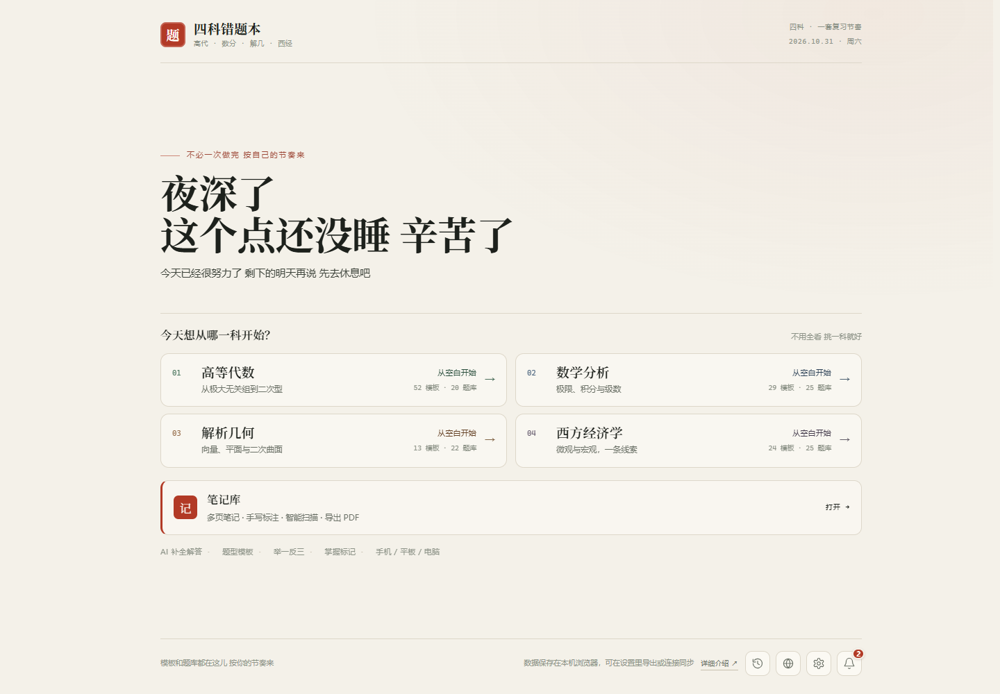
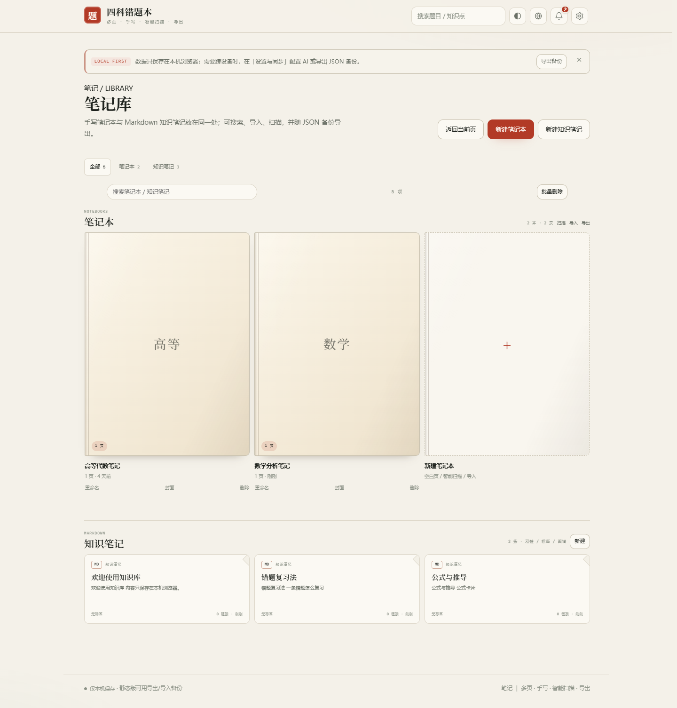
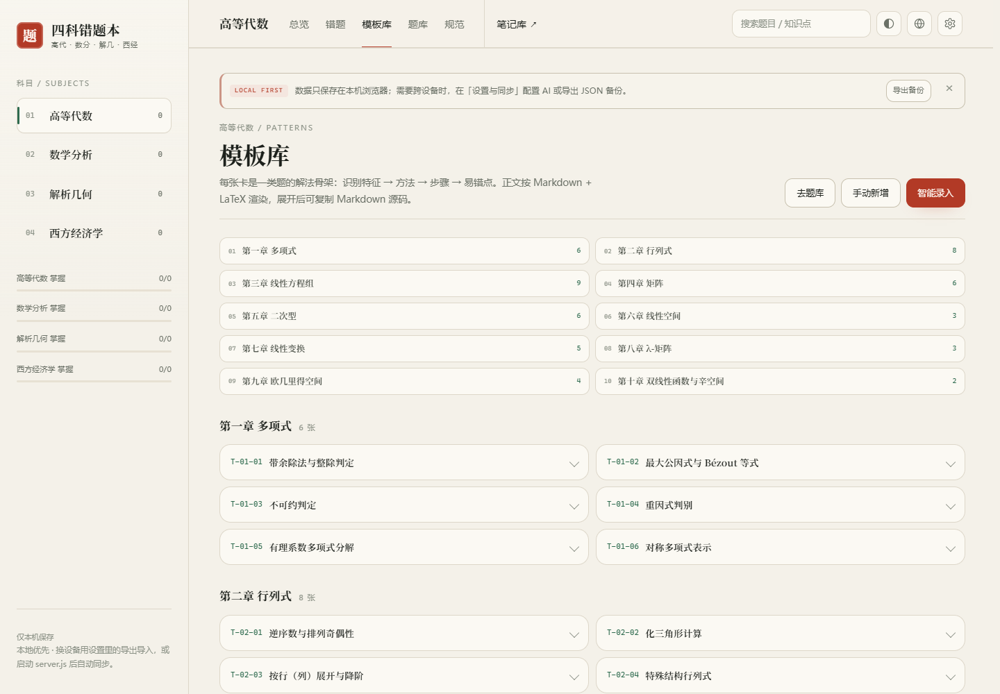
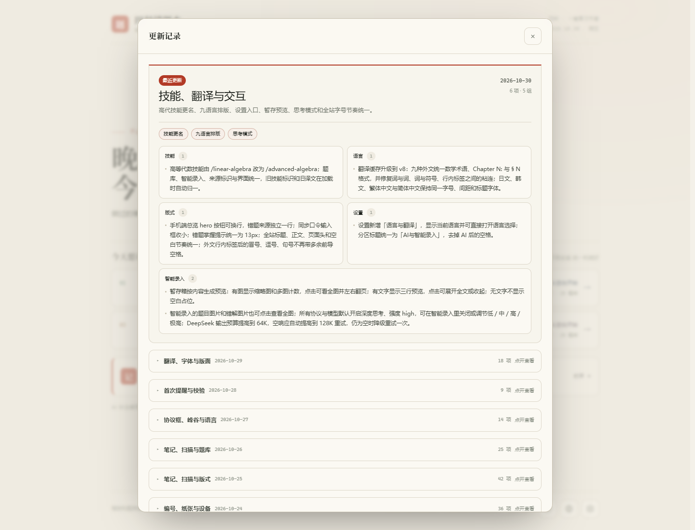
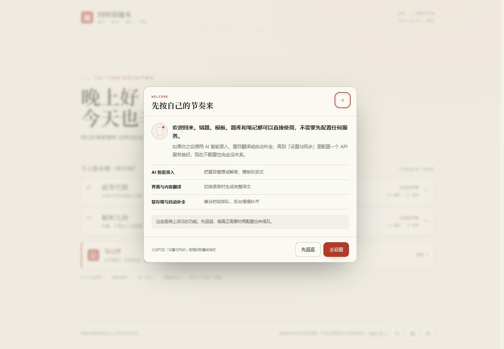

<h1>四科错题本</h1>

<b>高等代数 · 数学分析 · 解析几何 · 西方经济学</b> 
错题、模板、题库、AI 智能录入、手写笔记和 Markdown 知识笔记，放在一个单文件网页里。

<b>118</b> 解答模板 · <b>92</b> 道题库 · <b>4</b> 科 · <b>10</b> 种语言 · <b>0</b> 注册

<a href="https://lanzaihua.github.io/"><b>开始使用</b></a> · <a href="#功能">功能</a> · <a href="#界面">界面</a> · <a href="#更新记录">更新记录</a> · <a href="#隐私与限制">隐私与限制</a>

> 一个单文件学习工作台。错题、解答模板、举一反三题库、AI 智能录入和笔记共享同一套编号与复习节奏；数据默认只留在本机。

## 快速开始

1. 打开 <https://lanzaihua.github.io/>。
2. 选择一科，手动新增错题，或者把题目交给 AI 智能录入。
3. 先自己做一遍，再对照标准解答、详细解析和模板；用题库做同类型变式。

| 适合 | 现在包含 | 数据方式 |
|---|---|---|
| 大学高代、数分、解几、西经的错题整理与考前复习 | **118** 张解答模板 · **92** 道举一反三 · 统一笔记库 | 默认 localStorage；可导出 / 导入 JSON 备份 |

## 四个科目

| 科目 | 主要内容 | 模板 | 题库 |
|---|---|---:|---:|
| 高等代数 | 行列式、矩阵、线性方程组、向量空间、线性变换、特征值、二次型、欧氏空间 | 52 | 20 |
| 数学分析 | 极限、连续、导数、积分、级数、多元微积分、曲线曲面积分 | 29 | 25 |
| 解析几何 | 向量与坐标、平面与空间直线、柱面锥面旋转曲面、二次曲线与二次曲面 | 13 | 22 |
| 西方经济学 | 供求、弹性、消费者、生产者、成本、市场结构、市场失灵、GDP、IS-LM、AD-AS、失业、通胀、增长 | 24 | 25 |
| **合计** | | **118** | **92** |

四科分开建册。每科有自己的编号、章节、模板和题库，互不混淆。

## 功能

### 错题记录

- 册内唯一编号：高代 <code>A-001</code>、数分 <code>M-001</code>、解几 <code>G-001</code>、西经 <code>E-001</code>。
- 记录原题、考试标准解答、详细解析、答案、模板、章节、知识要点、难度和错因。
- 已掌握 / 未掌握状态会同步到首页和科目页统计。
- 支持关键词、章节、模板、难度、状态筛选，以及编辑、删除和展开阅读。

### 模板与题库

- 118 张模板按科目和章节组织，顶部章节目录可直接跳转。
- 模板固定四段：识别特征 / 首选方法 / 步骤骨架 / 易错点。
- 92 道题库题可以展开查看标准解答、详细解析、答案、解题要点和易错点。
- 模板、题库、错题条目都支持复制 Markdown 源码。

### 统一笔记库

- **手写笔记本**：笔、荧光笔、橡皮、直线、套索；10 种纸张；多页；插入文字和图片。
- **知识笔记**：Markdown、<code>[[双链]]</code>、反向链接、标签、全文搜索和关系图谱。
- **统一入口**：全部 / 笔记本 / 知识笔记切换，共用同一个搜索框。
- **智能扫描**：自动裁边、滤镜、旋转、连续扫描多页、OCR，保存后可导出 PDF。
- **导入导出**：图片、PDF 转页面；PNG / PDF 导出；数据随 JSON 备份。

### AI 智能录入

配置模型后，可以输入文字或上传题目图片，让 AI 一次生成考试标准解答、详细解析、答案、模板四段和 1–2 道变式。

- 支持 OpenAI 兼容接口、DeepSeek / DeepSeek Harness、Claude、Gemini、Grok、通义千问、Moonshot Kimi。
- 可选错解诊断：先指出错在哪一步、真正卡点、怎么改、下次怎么防，再给标准解答。
- DeepSeek 峰谷提示按官方规则：工作日 09:00–12:00、14:00–18:00 为峰时，周末和法定节假日全天谷时。
- 峰时可先暂存题目和图片，谷时再送入生成；暂存只存在本机。
- 新错题可自动进入补全队列；页面关闭后队列保留，下次打开继续。

### 数据、备份与语言

- 数据默认只在本机浏览器；换设备或清缓存前请先导出备份。
- JSON 备份包含错题、模板、题库、笔记和知识笔记；支持合并或覆盖导入。
- 当前语言备份会预翻译内容并输出 gzip 压缩的 <code>.json.gz</code>，文件更小。
- 10 种语言：简体中文、繁體中文、English、Français、Deutsch、日本語、한국어、Português、Русский、Español。
- 语言选择持久化；界面、题库、规范、笔记和弹窗使用同一套翻译缓存。

## 界面

统一首页 · 笔记库 · 模板库 · 更新记录

<table>
<tr>
<td width="50%"> <b>首页</b> · 按自己的节奏开始</td>
<td width="50%"> <b>笔记库</b> · 手写笔记本与 Markdown 知识笔记</td>
</tr>
<tr>
<td width="50%"> <b>模板库</b> · 章节索引与双列卡片</td>
<td width="50%"> <b>更新记录</b> · 版本摘要与分类阅读</td>
</tr>
</table>

 <b>首次进入</b> · 未配置 AI 时的一次温和提醒

## 屏幕适配

| 设备 | 视口 | 处理 |
|---|---|---|
| 手机 | 390 × 844 | 单列内容，操作按钮可横向滚动，弹窗内部滚动 |
| 平板竖屏 | 834 × 1112 | 隐藏侧栏，设置 780 宽，更新记录两列 |
| 平板横屏 | 1112 × 834 | 设置 860 宽，更新记录两列 |
| 电脑 | 1440 × 1000 | 正文限宽，设置 860，更新记录 860 / 两列 |

长表格、长公式在自身容器内横向滑动，不会把整页撑出横向滚动。

<b>适配验证命令</b>

    npm i -D playwright-core
    node tools/qa-responsive.js

检查范围：首页、总览、错题、模板库、题库、规范、笔记、设置、更新记录，以及横向溢出、弹窗高度和分栏。

## 更新记录

### 高代技能更名

2026-10-30 · **2 项 · 1 组**

高等代数技能由 /advanced-algebra 更名为 /advanced-algebra，题库、录入、历史来源与界面标识同步更新。

| 组 | 这版做了什么 |
|---|---|
| **技能** | 高等代数技能名称由 /advanced-algebra 改为 /advanced-algebra；技能目录、题库数据、智能录入、自动补全、来源标识和界面提示统一使用新名称。 |
| **技能** | 旧版本保存的 /advanced-algebra 技能标识与来源记录在加载时自动迁移为 /advanced-algebra；备份导入、同步和本机旧条目不需手动修改。 |

### 翻译、图标与版面

2026-10-29 · **18 项 · 4 组**

翻译续传、专业译名、四科缩写、字体与顶栏排版，以及提示条、笔记空状态和手机顶栏收口。

| 组 | 这版做了什么 |
|---|---|
| **语言** | 某个批次暂时翻译失败时不再丢弃；失败项进入后台重试队列，按 5–30 秒退避持续重试，直到全部翻译完成。 |
| **语言** | 翻译提示升级为学术出版级：按目标语言标准教材、期刊术语统一，保留公式、编号、引用与人名规则；新增公式、漏译与未翻译中文校验，缓存升级后旧译文自动重译。 |
| **语言** | 翻译缓存升级到 v7：旧版不规范的直译缓存失效；导航、按钮和页面标题等高频界面词改用九种语言的固定专业词表；正文按各语言教材与期刊文体重新翻译，并加入语言专属 UI 文体约束。 |
| **语言** | 品牌副标题在九种语言中使用四科缩写：Alg. · Anal. · Geom. · Econ.，与中文「高代 · 数分 · 解几 · 西经」对应；品牌行不再塞入完整科目名。 |
| **语言** | 品牌名改用固定短译名：Four-Subject Notebook、四科目ノート、Cahier des quatre matières 等，避免逐字机翻产生过长标题。 |
| **版式** | 顶栏历史、主题、语言、设置图标统一为 18×18、1.6 线宽；主题图标由字符改为同尺寸 SVG。 |
| **版式** | 桌面端展开的错题详情按内容分栏：纯文字标准解答与详细解析并排；含公式时自动通栏，避免长公式挤进另一列。正文取消固定字符宽度上限，右侧不再空出一大片。 |
| **版式** | 全站顶部提示压缩为一行，加「LOCAL FIRST」标签；笔记库空状态增加纸张预览，右侧不再空置。 |
| **版式** | 外文科目卡片把统计移到说明下方并横向排列，避免翻译后右侧空出一大块；中文布局保持不变。 |
| **版式** | 说明、引导和空状态文案取消固定 ch 宽度与平衡换行，按容器实际宽度贪心换行；右侧有空间时不再提前断行。 |
| **版式** | 页头操作按钮在宽屏保持一行，不再被标题说明挤成两行；窄屏仍可横向滚动。 |
| **版式** | 顶栏科目名与导航不再重叠：科目名固定宽度、超出省略，导航占剩余宽度；外文标签适当收紧，1440 / 1484 宽度下六项完整显示。 |
| **版式** | 外文导航只在需要时收紧：英文等长拉丁语种桌面使用 12.5px / 8px；日语、韩语、繁体中文在 1440 / 1484 保持与中文相同的 13.5px / 24px；901–1420 统一紧凑，手机端与中文相同。 |
| **版式** | 品牌名与四科简称改为上下两行，简称可随宽度自动换行；中英文都不再把简称挤在标题同一行。 |
| **字体** | 外文与中文标题、正文、品牌和标签使用同一字号；不再单独缩小外文界面文字。 |
| **字体** | 正文、说明、表单和主要界面文字统一无衬线；中文大标题保留宋体，外文页面与内容标题改用无衬线；品牌名和印章继续用宋体标记。 |
| **字体** | 主要标题和正文统一收小一档：桌面端首页大标题 66px、页面标题 37px、正文 14.5px，手机端同步收紧；首页继续左对齐，右侧只保留自然留白。 |
| **移动** | 手机端顶栏统一改为两行：品牌完整显示，搜索框独占一行并铺满可用宽度；搜索占位符与电脑端一致，恢复「搜索题目 / 知识点」，右侧图标不再挤压输入区。 |

<b>首次提醒与校验</b> · 2026-10-28 · 9 项 · 6 组

**欢迎页**：首次进入且未配置 AI 时出现一次温和提示；关闭后不再重复，恢复初始数据后重新提示。

**设置**：恢复初始数据会清除已读标记。

**错题**：日期统一为「YYYY-MM-DD HH:mm 星期X」，旧数据、导入、同步、手改与新增自动补全星期。

**版式**：全站页面头增加细分隔线；章节跳转增加顶部留白。

**语言**：搜索框占位符与浏览器标签页标题在语言切换、窗口变化和页面重绘后重新翻译。

**教材**：高等代数统一使用第 1–10 章作为章序；智能录入只接受规范章节，超出范围归一到对应章节，无法匹配标记为未分章。

<b>协议框、峰谷与语言</b> · 2026-10-27 · 14 项 · 6 组

**界面**：协议框统一；设置增加称呼；暂存箱改为峰谷时间轴、空队列插画与编号账页；弹窗去掉冗余「关闭」。

**智能录入**：DeepSeek 按官方峰谷规则提示；新增暂存箱，峰时先放题目和图片，谷时再生成。

**版式**：设置四组重排；空状态加入纸张标记；规范页增加速览卡；适配验证固定覆盖手机、平板横竖屏和电脑。

**笔记库**：新增 Obsidian 风格知识笔记；笔记库与知识库合并，统一搜索、类型切换和 Markdown 卡片。

**语言**：10 种语言菜单，按英文名 A–Z 排序；界面与内容 AI 翻译并缓存；修复串语言、弹窗不刷新、短字符与公式夹缝漏翻；可见界面优先、并行翻译、后台补齐长内容。

**备份**：AI 生成内容按当前语言写入；备份预翻译并输出 gzip 压缩的 <code>.json.gz</code>。

<b>笔记、扫描与题库</b> · 2026-10-26 · 25 项

- 笔记导出重排为范围 / 页面 / 格式；手机扫描改为预览、滤镜和固定底栏。
- 笔记工具栏改为两行分组；新增黑色纸、白色笔，笔色整理为 15 种。
- 错题自动进入题库，变式同步入库，答题模板自动补入模板库。
- JSON 备份包含模板和题库；编号冲突按章节重排；设置支持恢复初始数据。
- 更新记录改为版本摘要、重点标签和分类卡片；更早版本默认折叠。

<b>笔记、扫描与版式</b> · 2026-10-25

- 笔记库、多页笔记、智能扫描、封面、直线和套索复制、动态页码。
- 图片 / PDF 导入、排版；手机和平板适配。

<b>编号、纸张与设备</b> · 2026-10-24

- 6 种纸张、8 种笔色、插入文字 / 图片、更粗笔锋。
- 编号统一为 A / M / G / E；手机、平板和折叠屏适配。

<b>初版上线</b> · 2026-10-23

- 四科错题本上线；118 张模板、92 道题库。
- 掌握状态、搜索筛选、导出导入、本地 localStorage 与本机 server 同步。

完整记录见 [CHANGELOG.md](CHANGELOG.md)。

## 隐私与限制

- 不需要注册，没有账号系统，也没有云端用户数据。
- 错题默认只存在当前浏览器；换浏览器、换设备或清缓存不会自动迁移。
- AI Key 只存在浏览器；使用本机 server 时，页面携带的配置会发到你自己的服务端。
- 纯静态页的 AI 直连依赖接口 CORS；被浏览器拦截时请改用本机 server。
- 模型输出可能出错，请对照题干、课本和定理依据核对。
- 页面是学习辅助工具，不保证 AI 解答正确，也不替代教材、老师和考试要求。

## 本地运行

需要跨设备同步、服务端 AI 代理或局域网访问时：

    node server.js

默认地址：<http://127.0.0.1:4173>。手机访问：

    node server.js --lan

未配置 AI 时，错题、模板、题库、笔记等普通功能不受影响。

## 技术说明

- 单文件静态应用，部署在 GitHub Pages。
- Markdown 由 marked 解析，数学公式由 Temml 渲染。
- 无前端框架运行时依赖，打开 HTML 即可使用。
- 可选 Node 后端负责静态服务、状态同步和 AI 代理。
- 数据格式为浏览器 localStorage 中的 JSON，可通过页面导出 / 导入迁移。

## 反馈

如果发现排版、题目、模板或 AI 生成结果有问题，欢迎在仓库提 Issue，或直接在页面里修正自己的副本。

---

把做过的题留住，把下一次做对。

